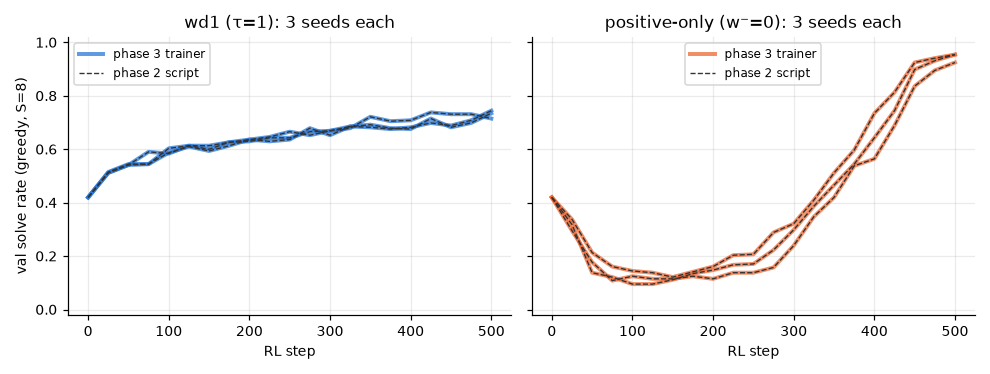

# 3.0 Generic RL trainer and reproduction of the phase 2 runs

**Goal:** check that the new phase 3 trainer (`src/phase3/rl.py`, pluggable objective and reward, extra diagnostics) gives the same results as the phase 2 script before anything is built on it.

**Prediction** (written before the runs):
- wd1 (β = 1, τ = 1) ends at 0.74 ± 0.01 test solve rate and never dips on val.
- Positive-only (β = 0, τ = 1) ends at 0.93 ± 0.02 after an early collapse to about 0.10–0.15 val near steps 75–150.
- Per-seed curves follow the phase 2 ones closely at first and then drift, because the order of random draws is the same but MPS is not bit-deterministic. In a 6-step smoke run the first three steps matched phase 2 to every printed digit.
- New diagnostics: at τ = 1 the share of w⁺ mass on invalid samples is 0.35–0.55 in the first steps, and the effective sample size of the weights stays above 6 of 8.

**Command**
```
for s in 0 1 2; do
  PYTHONPATH=src python -m phase3.rl --seed $s                                    # wd1
  PYTHONPATH=src python -m phase3.rl --seed $s --set rl.objective_params.beta=0   # positive-only
done
PYTHONPATH=src python -m phase3.analysis repro
```

- Config: `configs/phase3.yaml`, which reuses data, model and sampler from `configs/phase2.yaml`.
  - Init: `sft_weak.pt` (SFT step 120, val 0.42, test 0.48), pinned by sha256 in the config.
  - RL settings identical to 2.3a/2.3b: 500 steps, B = 32 puzzles × G = 8 rollouts (confidence, T = 1, S = 8), binary reward, μ = 4, AdamW lr 1e-5, grad-clip 1.0.
- Code: `src/phase3/{rl,objectives,rewards}.py`. Tests: `tests/test_objectives_sign.py`, `tests/test_rewards.py`.
- Diagnostics added per step: share of w⁺ on invalid samples, effective sample size of w⁺, gradient norm, one-step predictive entropy, and val solve rate at S = 1 next to S = 8.
- Hardware: Apple M5 24 GB, macOS 27.0.1, Python 3.12.13, torch 2.15.0, MPS, fp32, nothing else running on the GPU. Seeds 0, 1, 2.
- Wall-clock: 54–56 s per run, 5.5 min for the six runs.
- Results:
  - `results/phase3/rl/wd1_beta{1,0}_tau1_seed{0,1,2}.{csv,json}`
  - `results/phase3/repro_3.0_runs.csv`, `results/phase3/repro_3.0_summary.csv`, `results/phase3/repro_3.0.png`
  - Checkpoints (local only): `~/dllm-cache/phase3/rl/<run>/{best,final}.pt`

## Outcome



| | val solve (step 500) | test solve (step 500) | lowest val during training |
|---|---|---|---|
| wd1, phase 2 script | 0.731 ± 0.015 | 0.738 ± 0.005 | 0.42 (the start) |
| wd1, phase 3 trainer | 0.731 ± 0.015 | 0.738 ± 0.005 | 0.42 (the start) |
| positive-only, phase 2 script | 0.944 ± 0.017 | 0.932 ± 0.016 | 0.108 (steps 75–150) |
| positive-only, phase 3 trainer | 0.944 ± 0.017 | 0.932 ± 0.016 | 0.108 (steps 75–150) |

Mean ± std over 3 seeds.

Prediction check:
- **Final solve rates: as predicted**, and closer than predicted. For every seed the val curve (21 evaluations) and the final test solve rate are equal to phase 2's. The rollout reward is identical at all 500 steps, and the logged log p̂ values differ by at most 4e-6.
- **"Curves drift apart": wrong.** MPS was repeatable for this model across two code paths and two sessions. That is an observation about these runs, not a guarantee.
- **Weight diagnostics: as predicted.** In steps 1–50 the share of w⁺ on invalid samples is 0.36 (wd1) and 0.45 (positive-only), and the effective sample size never goes below 6.3 of 8.

First look at the new diagnostics (means over 3 seeds; observations only, to be followed up in 3.1):

| | steps 1–50 | steps 301–500 |
|---|---|---|
| wd1: share of w⁺ on invalid samples | 0.36 | 0.19 |
| positive-only: share of w⁺ on invalid samples | 0.45 | 0.25 |
| wd1: one-step predictive entropy (nats, max 1.39) | 0.84 | 0.56 |
| positive-only: one-step predictive entropy | 0.95 | 0.81 |

- **Every update was clipped.** The gradient norm, averaged over the 4 inner steps, was above the clip threshold of 1.0 in all 3,000 RL steps (minimum 1.97, median 4.9 for wd1 and 7.5 for positive-only). So the two variants took steps of the same size and differed only in direction. This matters for the β sweep in 3.1c: scaling the loss will not change the step size.
- **One-shot solving (S = 1) improves much more under positive-only:** val solve rate at S = 1 ends at 0.24, against 0.06 for wd1. Both start at 0.00.

**Shows:** the phase 3 trainer reproduces the phase 2 wd1 and positive-only runs, so later differences come from the objective or reward and not from the new code.
**Does not show:** anything new about wd1 itself. The diagnostics above are single-setting observations, and exact repeatability on MPS may not hold for other models or torch versions.
