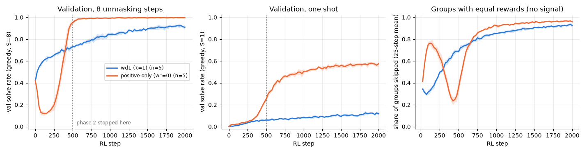

# 3.1a Was step 500 too early? wd1 and positive-only for 2000 steps

**Goal:** phase 2 compared wd1 and positive-only at 500 RL steps, when wd1 was still improving. Run both four times longer and see whether the ranking holds. The result also fixes the standard horizon for the rest of phase 3.

**Prediction** (written before the runs):
- wd1 keeps climbing but slows down as more groups are skipped. It ends at 0.85 ± 0.05 test solve rate and does not catch positive-only.
- Positive-only reaches at least 0.97 by step 1000 and stays at or above 0.95 until step 2000, with no second collapse.
- By the end more than 80% of the groups are skipped in both variants, because all 8 rollouts are valid.

**Rule for the standard horizon** (fixed before the runs): the first evaluation step at which the seed-mean val solve rate of *both* variants is within 0.02 of its value at step 2000, rounded up to a multiple of 500.

**Command**
```
bash scripts/run_phase3.sh 3.1a ~/dllm-cache/venv/bin/python
PYTHONPATH=src python -m phase3.analysis 3.1a
```

- Config: `configs/phase3.yaml` with `rl.max_rl_steps=2000`; wd1 is `beta=1`, positive-only is `beta=0`, both at τ = 1. Seeds 0–4. Everything else as in 3.0. For seeds 0–2 the first 500 steps are the 3.0 runs again.
- Code: `src/phase3/rl.py`, `scripts/run_phase3.sh`.
- Hardware: Apple M5 24 GB, macOS 27.0.1, Python 3.12.13, torch 2.15.0, MPS, fp32. Seeds 0–4.
- Wall-clock: about 3.7 min per run alone; three runs in parallel took about 7 min. The `wall_clock_s` column is not a clean timing: runs were interrupted and resumed while the launcher was being changed, and other jobs shared the GPU.
- Results: `results/phase3/3.1a/` (`curves.csv` one row per evaluation, `runs.csv`, `summary.csv`, `val_by_step.csv`, `horizon.json`, `horizon.png`). Per-step logs and checkpoints stay local in `~/dllm-cache/phase3/3.1a/`.
- Run notes:
  - The first three runs used the trainer as of commit `f0be58a`; the others resumed or started on the extended trainer (commit `19917e9`), which was checked to reproduce the 3.0 numbers. For seeds 0–2 the val curves up to step 500 are equal to the 3.0 runs, including the runs that were interrupted and resumed.
  - Resumed runs had per-step logs with two header formats (the extended trainer adds one column). The local logs were repaired by inserting the empty column; no value was changed.

## Outcome



Val solve rate, mean ± std over 5 seeds:

| | step 500 | step 1000 | step 1500 | step 2000 | test, step 2000 | test with one unmasking step |
|---|---|---|---|---|---|---|
| wd1 (τ = 1) | 0.733 ± 0.012 | 0.843 ± 0.017 | 0.895 ± 0.009 | 0.910 ± 0.021 | 0.907 ± 0.017 | 0.106 ± 0.008 |
| positive-only | 0.951 ± 0.015 | 0.991 ± 0.005 | 0.994 ± 0.005 | 0.997 ± 0.003 | 0.997 ± 0.001 | 0.589 ± 0.017 |

Prediction check:
- **wd1 "ends at 0.85 ± 0.05 and does not catch positive-only": right on the ranking, slightly low on the level.** wd1 ends at 0.907, just above the predicted range, and is still 9 points behind positive-only in every seed.
- **Positive-only "at least 0.97 by step 1000, no second collapse": right.** 0.991 at step 1000 and 0.997 at step 2000. The only dip is the early one (lowest val 0.11 near step 100, in all 5 seeds).
- **"More than 80% of groups skipped by the end": right.** 92% for wd1 and 96% for positive-only over steps 1501–2000.

Other observations:
- wd1's gain per step shrinks as the skipped share grows: +0.11 from step 500 to 1000, +0.05 to 1500, +0.015 to 2000. Late in training only about 1 group in 12 gives any gradient.
- The two variants end with similar sharpness of the one-step prediction (entropy 0.52 and 0.50 nats) but very different estimated likelihoods of their own valid rollouts: −11.8 for wd1 and −4.3 for positive-only. With a single unmasking step positive-only solves 59% of the test puzzles and wd1 11%.

**Standard horizon:** by the rule above, the seed-mean val of both variants is within 0.02 of its step-2000 value from step 1450, so the horizon for the rest of phase 3 is **1500 steps**.

**Shows:** the phase 2 ranking was not an artefact of stopping at step 500. With four times the steps wd1 narrows the gap (from 20 points to 9) but positive-only stays ahead in every seed, on this task and from this starting model.
**Does not show:** why. Whether the early collapse comes from flat weights, and whether the ranking depends on the starting model, are 3.1b and 3.1d. Nothing here says how the two behave at LLaDA scale.
