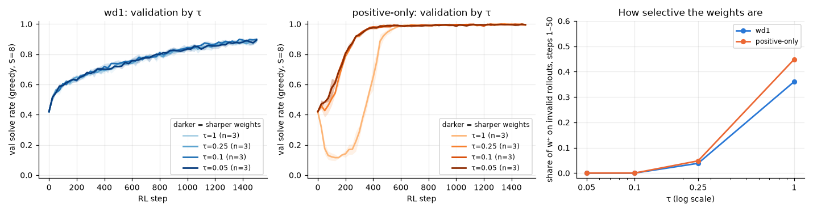

# 3.1b What happens when the weights are actually sharp? τ sweep for wd1 and positive-only

**Goal:** in phase 2 (τ ∈ {0.5, 1, 2}) the softmax weights were almost uniform, so τ was never really tested. With 0/1 rewards and m valid rollouts out of G, the share of w⁺ on invalid rollouts is (G − m) / ((G − m) + m·e^(1/τ)): for m = 2 that is 52% at τ = 1, 5% at τ = 0.25 and about 0% at τ = 0.1. If positive-only collapses early because it reinforces its own mistakes, the collapse should shrink as τ falls.

**Prediction** (written before the runs):
- Positive-only: the early dip gets shallower as τ falls. The lowest seed-mean val solve rate is at least 0.30 for τ ≤ 0.1, against 0.11 at τ = 1. The final solve rate is at least 0.97 at every τ.
- wd1: lower τ makes it faster. At τ ≤ 0.1 its final val solve rate is at least 0.03 above τ = 1, but still below positive-only at the same τ. It never dips below the start at any τ.

**Rule for the "best τ"** used by 3.1c and 3.1e (fixed before the runs): the τ in {0.25, 0.1, 0.05} with the highest seed-mean final val solve rate for wd1; values within 0.01 of the best count as ties and the largest such τ is taken.

**Command**
```
bash scripts/run_phase3.sh 3.1b ~/dllm-cache/venv/bin/python
PYTHONPATH=src python -m phase3.analysis 3.1b
```

- Config: `configs/phase3.yaml`; τ ∈ {1, 0.25, 0.1, 0.05} × β ∈ {1 (wd1), 0 (positive-only)}, seeds 0–2, at the standard horizon fixed by 3.1a. Everything else as in 3.0.
- Code: `src/phase3/rl.py`, `src/phase3/objectives.py`.
- Hardware: Apple M5 24 GB, macOS 27.0.1, Python 3.12.13, torch 2.15.0, MPS, fp32. Seeds 0–2. Horizon 1500 steps (from 3.1a).
- Wall-clock: 75 min for the 24 runs, four at a time, with the 3.4b runs sharing the GPU (about 2.8 min per run alone).
- Results: `results/phase3/3.1b/` (`curves.csv`, `runs.csv`, `summary.csv`, `best_tau.json`, `tau_sweep.png`).

## Outcome



Mean ± std over 3 seeds, 1500 steps:

| | τ | share of w⁺ on invalid rollouts, steps 1–50 | lowest val during training | final val | final test |
|---|---|---|---|---|---|
| positive-only | 1 | 0.45 | 0.108 (step 100) | 0.993 ± 0.007 | 0.996 ± 0.004 |
| positive-only | 0.25 | 0.05 | 0.407 | 0.996 ± 0.002 | 0.997 ± 0.001 |
| positive-only | 0.1 | 0.00 | 0.420 (the start) | 0.996 ± 0.002 | 0.997 ± 0.001 |
| positive-only | 0.05 | 0.00 | 0.420 (the start) | 0.995 ± 0.005 | 0.998 ± 0.000 |
| wd1 | 1 | 0.36 | 0.420 (the start) | 0.895 ± 0.006 | 0.860 ± 0.020 |
| wd1 | 0.25 | 0.04 | 0.420 (the start) | 0.890 ± 0.010 | 0.874 ± 0.012 |
| wd1 | 0.1 | 0.00 | 0.420 (the start) | 0.898 ± 0.006 | 0.886 ± 0.009 |
| wd1 | 0.05 | 0.00 | 0.420 (the start) | 0.895 ± 0.016 | 0.884 ± 0.004 |

Prediction check:
- **Positive-only "the dip gets shallower as τ falls, lowest val at least 0.30 for τ ≤ 0.1": right, and stronger than predicted.** At τ ≤ 0.1 there is no dip at all, and at τ = 0.25 only a 1-point dip. With sharp weights positive-only passes 0.9 val at about step 300, against step 450–500 at τ = 1. The final solve rate is at least 0.995 at every τ, as predicted.
- **wd1 "at τ ≤ 0.1 final val at least 0.03 above τ = 1": wrong.** The four val curves lie on top of each other (0.890–0.898 at the end). Final test is 2.6 points higher at τ = 0.1 than at τ = 1, which is within about one standard deviation of the τ = 1 runs. wd1 is insensitive to τ here even when τ really changes the weights.
- **wd1 "never dips, and stays below positive-only at the same τ": right.**

**Best τ for 3.1c and 3.1e:** by the rule above, wd1's final val is 0.890, 0.898 and 0.895 at τ = 0.25, 0.1 and 0.05. All are within 0.01 of the best, so the largest is taken: **τ = 0.25**.

**Shows:** on this task the early collapse of positive-only goes with flat weights: it is deep when about half of the positive weight falls on invalid rollouts (τ = 1) and gone when almost none does (τ ≤ 0.1). The collapse is therefore not a property of dropping the negative term as such. wd1's slower progress is not a matter of τ.
**Does not show:** that flat weights are the only cause, since τ also changes how the weight is shared among the valid rollouts. It also does not say why wd1 is slower; the β sweep (3.1c) and the comparison with other objectives (3.2) look at that. One starting model, 3 seeds.
