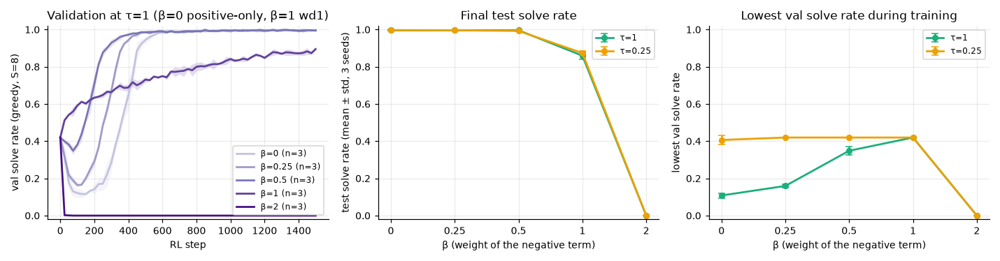

# 3.1c How much negative push is the right amount? β sweep and a floored negative term

**Goal:** wd1 and positive-only are the two ends of one family, loss = Σ (β·w⁻ − w⁺)·log p̂, with β = 1 and β = 0. Sweep β to see how the early collapse and the final solve rate depend on the size of the negative term. Also try a floored negative term, which stops pushing a rollout down once its log p̂ is below a floor. The floor is motivated by the phase 2 logs (wd1 lowered the likelihood of valid rollouts too) and is not from the wd1 paper.

Note from 3.0: every gradient is clipped to norm 1, so β changes the direction of the update, not its size.

**Prediction** (written before the runs), at τ = 1:
- With 2 valid rollouts out of 8, the net coefficient on an invalid rollout is β·0.148 − 0.087, which is negative (a push *up*) for β below about 0.59. So β = 0.25 and β = 0.5 still dip early, less deeply as β grows; β = 1 and β = 2 do not dip.
- The final solve rate decreases with β: β = 0.25 ends within 0.02 of positive-only, β = 0.5 in between, β = 2 ends below β = 1.
- Floor: with the floor at −12 or −15 the estimated likelihood of valid rollouts falls less than under plain wd1, and the final test solve rate is at least as high as plain wd1's (within noise or better).

**Command**
```
bash scripts/run_phase3.sh 3.1c ~/dllm-cache/venv/bin/python
PYTHONPATH=src python -m phase3.analysis 3.1c
```

- Config: `configs/phase3.yaml`; β ∈ {0.25, 0.5, 2} at τ = 1 and at the best τ from 3.1b, plus floor ∈ {−12, −15} at τ = 1, β = 1. Seeds 0–2, standard horizon. The β = 0 and β = 1 cells are the 3.1b runs.
- Code: `src/phase3/objectives.py` (`wd1`, `weighted_loss`). Test of the floor: `tests/test_objectives_sign.py`.
- Hardware: Apple M5 24 GB, macOS 27.0.1, Python 3.12.13, torch 2.15.0, MPS, fp32. Seeds 0–2, 1500 steps. Best τ from 3.1b: 0.25.
- Wall-clock: 3.1c and 3.2b ran in one launch, 36 runs in 2 h 10 min, three at a time, with CPU jobs from 3.4b running alongside (about 2.8 min per run alone). The first runs were interrupted once and resumed.
- Results: `results/phase3/3.1c/` (`curves.csv`, `runs.csv`, `summary.csv`, `floor.csv`, `beta_sweep.png`).

## Outcome



Mean ± std over 3 seeds. β = 0 and β = 1 are the 3.1b runs.

| β | τ = 1: lowest val | τ = 1: final test | τ = 0.25: lowest val | τ = 0.25: final test |
|---|---|---|---|---|
| 0 (positive-only) | 0.11 | 0.996 ± 0.004 | 0.41 | 0.997 ± 0.001 |
| 0.25 | 0.16 | 0.996 ± 0.000 | 0.42 (start) | 0.996 ± 0.000 |
| 0.5 | 0.35 | 0.996 ± 0.003 | 0.42 (start) | 0.992 ± 0.003 |
| 1 (wd1) | 0.42 (start) | 0.860 ± 0.020 | 0.42 (start) | 0.874 ± 0.012 |
| 2 | 0.00 | 0.000 | 0.00 | 0.000 |

Floored negative term, τ = 1, β = 1:

| floor | final test | test with one unmasking step | log p̂ of valid rollouts, last 250 steps |
|---|---|---|---|
| none (wd1) | 0.860 ± 0.020 | 0.078 | −12.5 |
| −15 | 0.985 ± 0.003 | 0.231 | −6.4 |
| −12 | 0.991 ± 0.002 | 0.311 | −5.9 |

Prediction check:
- **"β = 0.25 and 0.5 still dip at τ = 1, less deeply as β grows": right.** Lowest val 0.11, 0.16, 0.35 for β = 0, 0.25, 0.5.
- **"β = 1 and β = 2 do not dip": wrong for β = 2.** With β = 2 the model is destroyed: val solve rate is 0.000 from step 25–75 on, in all 6 runs, and it never recovers.
- **"The final solve rate decreases with β, with β = 0.5 in between": wrong in shape.** It is a cliff, not a slope. Every β below 1 ends at 0.99 or more, β = 1 ends at 0.86–0.87, β = 2 ends at 0.
- **Floor "at least as high as plain wd1, valid likelihood falls less": right, by much more than expected.** A floor at −12 lifts wd1 from 0.860 to 0.991 test. The estimated likelihood of valid rollouts ends near −6 instead of −12.5.

Reading the floor result: below the floor a rollout keeps its positive weight and loses its negative one, so it is pushed *up* whether or not it is valid. The floored objective is therefore wd1 for likely rollouts and positive-only for unlikely ones. It is not a pure "stop pushing" rule, and its behaviour sits between the two (one-step solve rate 0.31, against 0.08 for wd1 and 0.58 for positive-only).

**Shows:** on this task the sum of the coefficients decides the outcome. When the push up outweighs the push down (β < 1, or the floor), the model ends near 100%; when they balance (β = 1) it is slow; when the push down dominates (β = 2) it collapses for good. wd1 sits exactly at the balance point.
**Does not show:** that the balance point is a bad choice in general. The likelihood here is a one-step proxy, the reward is binary, there are 16 cells and 4 digits. A floor of −12 is a number chosen from this task's logs, not a recipe.
