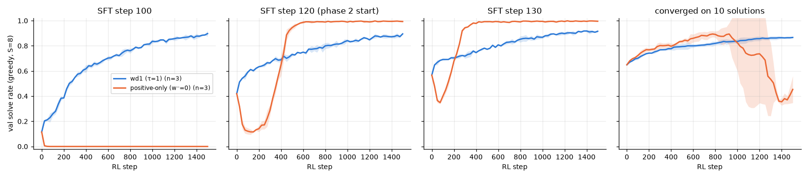

# 3.1d Does the starting model change the story?

**Goal:** phase 2 started RL from one snapshot (SFT step 120, val 0.42) of a model that reaches 0.85 thirty SFT steps later. One suspected reason for positive-only's win is that this snapshot is "one sharpening step away" from solving. Test other starting points:

| Start | What it is |
|---|---|
| SFT step 100 | earlier snapshot, val 0.11 |
| SFT step 120 | the phase 2 start, val 0.42 (runs from 3.1b) |
| SFT step 130 | later snapshot, val 0.57 |
| converged on few solutions | SFT run to convergence on the puzzles of only N of the 200 train solutions. N is chosen in a pilot over {2, 5, 10, 20, 40} as the one whose final val solve rate is in [0.3, 0.6] and closest to 0.45, or the closest to 0.45 if none is in the window. RL then uses puzzles from all 200 solutions with the validity checker only. |

The last row is the realistic case for RL: few labels, a cheap checker, and a model that is weak because it has seen little, not because training was stopped early.

**Prediction** (written before the runs, including the SFT pilot):
- Step 100: positive-only collapses to nearly 0 and ends below 0.5 in at least 2 of 3 seeds. wd1 improves slowly and ends below 0.6.
- Step 130: positive-only dips less than from step 120 (lowest val at least 0.25) and ends at 0.97 or more. wd1 ends around 0.9.
- Converged on few solutions: the ranking flips. Positive-only gains less than 0.2 over its start and shows no collapse-then-recovery pattern, because the model is already sharp and its errors are systematic. wd1 gains more than positive-only.

**Command**
```
bash scripts/run_phase3.sh 3.1d-sft ~/dllm-cache/venv/bin/python     # SFT on N solutions, N in {2, 5, 10, 20, 40}
PYTHONPATH=src python -m phase3.analysis 3.1d-sft                    # picks N, writes chosen_subset.txt
bash scripts/run_phase3.sh 3.1d ~/dllm-cache/venv/bin/python
PYTHONPATH=src python -m phase3.analysis 3.1d
```

- Config: `configs/phase3.yaml`; wd1 (β = 1) and positive-only (β = 0) at τ = 1, seeds 0–2, standard horizon.
- Code: `src/phase3/sft_subset.py` (same model, loss, optimiser and schedule as phase 2 SFT; 5,000 steps), `src/phase3/rl.py --init`.
- Hardware: Apple M5 24 GB, macOS 27.0.1, Python 3.12.13, torch 2.15.0, MPS, fp32. Seeds 0–2, 1500 RL steps.
- Wall-clock: SFT pilot about 9 min per model (five models, three at a time); 3.1d and 3.1f ran in one launch, 27 runs in 78 min.
- Results: `results/phase3/3.1d/` (`sft_subset_*.csv/json`, `sft_subset_summary.csv`, `sft_subset.png`, `chosen_subset.txt`, `curves.csv`, `runs.csv`, `summary.csv`, `starting_model.png`). The subset checkpoints stay local in `~/dllm-cache/phase3/3.1d/sft/`.

## Outcome

### The model converged on few solutions

| N train solutions | puzzles | final val | solve rate on the N seen solutions | on unseen train solutions |
|---|---|---|---|---|
| 2 | 263 | 0.003 | 1.00 | 0.00 |
| 5 | 635 | 0.095 | 1.00 | 0.07 |
| **10** | 1,289 | **0.649** | 1.00 | 0.67 |
| 20 | 2,575 | 0.964 | 1.00 | 0.97 |
| 40 | 5,091 | 0.993 | 1.00 | 0.99 |

No N landed in the 0.3–0.6 window, so by the rule the closest to 0.45 was taken: **N = 10** (val 0.649, test 0.590, flat over the last 1,000 SFT steps). The model goes from 10% to 96% between 5 and 20 solutions. Unlike the phase 2 start it is sharp: its one-step predictive entropy is 0.09 nats against 0.84.

### RL from each start



Mean ± std over 3 seeds, 1500 steps, τ = 1:

| Start (val solve rate) | wd1: final test | positive-only: final test | positive-only: lowest val |
|---|---|---|---|
| SFT step 100 (0.11) | 0.879 ± 0.004 | 0.000 | 0.00 from step 25–75 |
| SFT step 120 (0.42), from 3.1b | 0.860 ± 0.020 | 0.996 ± 0.004 | 0.11 |
| SFT step 130 (0.57) | 0.916 ± 0.016 | 0.997 ± 0.002 | 0.35 |
| converged on 10 solutions (0.65) | 0.791 ± 0.011 | 0.480 ± 0.100 | 0.31 (late) |

Prediction check:
- **Step 100, positive-only "collapses and ends below 0.5 in at least 2 of 3 seeds": right, in all 3.** It goes to 0.000 within 75 steps and never recovers.
- **Step 100, wd1 "improves slowly and ends below 0.6": wrong.** wd1 climbs from 0.11 to 0.88, although only 1–2% of its rollouts are valid at first and 90% of the groups are skipped.
- **Step 130: right.** Positive-only dips to 0.35 and ends at 0.997; wd1 ends at 0.916.
- **Converged start, "the ranking flips": right at the end, but the path was not predicted.** Positive-only first rises faster than wd1 (best val 0.87–0.98 between steps 800 and 1225), then collapses in all 3 seeds and ends at 0.48, below its start. wd1 rises slowly and steadily to 0.79. With early stopping on val, positive-only's best checkpoints score 0.913 ± 0.068 on test against 0.788 ± 0.012 for wd1's.

Notes from the logs:
- From the converged start 99–100% of the groups are skipped in both variants: the model is sharp, so its 8 rollouts usually share the same reward. Both variants learn from about 1 group in 100.
- Positive-only's late collapse there comes with the same signature as the early one from step 120: the estimated likelihood of its invalid rollouts rises (from −16 to −4) and the share of w⁺ on invalid rollouts doubles.

**Shows:** the phase 2 ranking is a property of the starting snapshot. Positive-only at τ = 1 wins only from the two mid-warm-up snapshots. Ten SFT steps earlier it destroys the model, and from a model converged on little data it rises and then collapses. wd1 improves from every start and never collapses; it is slower but robust.
**Does not show:** how the sharper, safer variants from 3.1b, 3.1c, 3.2 and 3.2b (sharp weights, filtered imitation, self-training, floor, KL) behave from these other starts. That is 3.1g.
