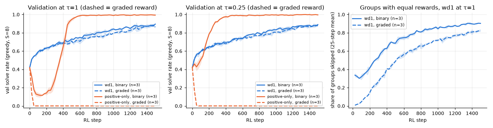

# 3.1e Does a graded reward help?

**Goal:** the 0/1 reward gives no signal when all 8 rollouts of a puzzle are invalid, and treats a grid with one wrong cell like a random grid. Try a graded reward that needs no labels: the share of the 12 units (4 rows, 4 columns, 4 boxes) that contain each digit once. It equals 1 exactly when the grid is valid. Evaluation stays the binary solve rate.

**Prediction** (written before the runs):
- Fewer groups are skipped early on (the rewards within a group are rarely all equal).
- wd1 with the graded reward climbs faster in the first 300 steps and ends within 0.03 of wd1 with the binary reward.
- Positive-only at τ = 1 dips at least as deeply as with the binary reward, because the reward spread within a group is smaller and the weights are even flatter. At the best τ from 3.1b the dip is much smaller. It still ends at 0.95 or more in both cases.

**Command**
```
bash scripts/run_phase3.sh 3.1e ~/dllm-cache/venv/bin/python
PYTHONPATH=src python -m phase3.analysis 3.1e
```

- Config: `configs/phase3.yaml` with `rl.reward=graded`; β ∈ {1, 0} × τ ∈ {1, best τ from 3.1b}, seeds 0–2, standard horizon. The binary-reward cells are the 3.1b runs.
- Code: `src/phase3/rewards.py` (`graded`). Test: `tests/test_rewards.py`.
- Hardware: Apple M5 24 GB, macOS 27.0.1, Python 3.12.13, torch 2.15.0, MPS, fp32. Seeds 0–2, 1500 steps, best τ from 3.1b = 0.25.
- Wall-clock: 3.1e and 3.3 ran in one launch, 24 runs in 92 min, three at a time.
- Results: `results/phase3/3.1e/` (`curves.csv`, `runs.csv`, `summary.csv`, `graded_reward.png`).

## Outcome



Mean ± std over 3 seeds. The binary rows are the 3.1b runs.

| | τ | reward | groups skipped, steps 1–300 | val at step 300 | final test |
|---|---|---|---|---|---|
| wd1 | 1 | binary | 0.40 | 0.663 | 0.860 ± 0.020 |
| wd1 | 1 | graded | 0.12 | 0.661 | 0.848 ± 0.006 |
| wd1 | 0.25 | binary | 0.39 | 0.683 | 0.874 ± 0.012 |
| wd1 | 0.25 | graded | 0.12 | 0.674 | 0.863 ± 0.012 |
| positive-only | 1 | binary | 0.67 | 0.286 | 0.996 ± 0.004 |
| positive-only | 1 | graded | 0.39 | 0.000 | 0.000 |
| positive-only | 0.25 | binary | 0.24 | 0.921 | 0.997 ± 0.001 |
| positive-only | 0.25 | graded | 0.32 | 0.000 | 0.000 |

Prediction check:
- **"Fewer groups are skipped early": right for wd1** (12% against 40%).
- **wd1 "climbs faster in the first 300 steps and ends within 0.03 of binary": half right.** It ends within 0.012 of the binary runs, but it is not faster: val at step 300 is the same (0.66–0.68).
- **Positive-only "dips at least as deeply at τ = 1, much less at the best τ, and ends at 0.95 or more": wrong.** With the graded reward positive-only goes to 0.000 within 50–75 steps at both temperatures, in all 6 runs, and never recovers. In the first 25 steps 70–80% of its positive weight is on invalid rollouts, and by step 75 all of it is. The model ends up writing nearly the same invalid grid with high likelihood (log p̂ about −2).

Why τ = 0.25 does not save positive-only here: every rollout now has a reward between about 0.5 and 1, so the advantages within a group differ by tenths rather than by 1, and the weights are flat again even at τ = 0.25. This fits the 3.1b account, in which flat weights are what makes positive-only collapse.

**Shows:** a graded reward gave wd1 more groups to learn from but no better result, and it made positive-only unusable at the temperatures that were safe with the binary reward. An objective that is safe only when the weights happen to be selective depends on the reward scale; wd1 does not.
**Does not show:** what a much smaller τ, or weights computed on ranks, would do with the graded reward. Not tried.
