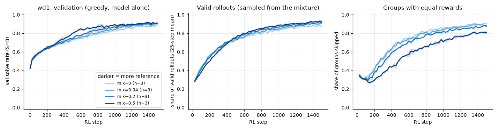

# 3.1f Does a reference policy temper wd1?

**Goal:** phase 2 listed "no KL/reference term" as a possible reason for wd1's lower result. Before implementing anything, the upstream wd1 code was read (github.com/xiaohangt/wd1, commit `1a2e254`, pinned in `configs/phase3.yaml`):

- The loss in `wd1/trainers/rev_grpo_trainer.py` is −Σ softmax(A)·log p̂ + Σ softmax(−A)·log p̂ with A = r − group mean. That is the phase 2 loss with τ = 1. There is no reference or KL term in the loss.
- The positive-only trainer (`rev_grpo_trainer_psr.py`) drops the second sum, as in phase 2.
- The reference policy appears only in the variant `wll_d1_neg_ref` (`rev_grpo_ref_pol_trainer.py`), and there it enters the *sampling*: rollouts are drawn from mixed logits, (1 − β_ref)·current + β_ref·reference, with β_ref = 0.04 by default. The loss is unchanged.

Toy equivalent: `rl.ref_mix` samples the rollouts from (1 − mix)·current + mix·frozen-start logits. Differences from upstream: the reference is the frozen starting checkpoint rather than a LoRA-free base model, and the model is the 0.8M toy.

**Prediction** (written before the runs): mix = 0.04 is indistinguishable from no reference. Mix = 0.2 and 0.5 lower the share of skipped groups late in training, because the rollouts stay more diverse. For all three values the final test solve rate is within 0.03 of wd1 without a reference.

**Command**
```
bash scripts/run_phase3.sh 3.1f ~/dllm-cache/venv/bin/python
PYTHONPATH=src python -m phase3.analysis 3.1f
```

- Config: `configs/phase3.yaml` with `rl.ref_mix` ∈ {0.04, 0.2, 0.5}; wd1 (β = 1, τ = 1), seeds 0–2, standard horizon. The no-reference cell is the 3.1b run.
- Code: `src/phase3/rl.py` (`MixedLogits`).
- Hardware: Apple M5 24 GB, macOS 27.0.1, Python 3.12.13, torch 2.15.0, MPS, fp32. Seeds 0–2, 1500 steps.
- Wall-clock: ran in the same launch as 3.1d (27 runs in 78 min).
- Results: `results/phase3/3.1f/` (`curves.csv`, `runs.csv`, `summary.csv`, `reference_mix.png`).

## Outcome



Mean ± std over 3 seeds:

| mix | final val | final test | groups skipped, last 250 steps |
|---|---|---|---|
| 0 (wd1, from 3.1b) | 0.895 ± 0.006 | 0.860 ± 0.020 | 0.90 |
| 0.04 (upstream default) | 0.904 ± 0.005 | 0.904 ± 0.005 | 0.89 |
| 0.2 | 0.906 ± 0.012 | 0.897 ± 0.008 | 0.87 |
| 0.5 | 0.911 ± 0.010 | 0.896 ± 0.007 | 0.80 |

Prediction check:
- **"Mix = 0.2 and 0.5 lower the share of skipped groups": right, mildly.** 0.87 and 0.80 against 0.90.
- **"All within 0.03 of wd1 on test, 0.04 indistinguishable": right on val, slightly wrong on test.** On val all four are within 0.016. On test the three mixes are 3.6 to 4.4 points above plain wd1, which is about two standard deviations of the plain runs. There is no dose-response: 0.04 does as well as 0.5, although at 0.04 the rollouts barely differ. Plain wd1's test score at 1500 steps is below its val score in both 3.1b (3 seeds) and 3.2 (5 seeds: 0.865 test, 0.896 val), so part of the gap may come from the baseline side.

**Shows:** mixing the starting model into the rollouts, the way upstream wd1 uses a reference, does not change wd1's behaviour much here. It is nowhere near the effect of a KL penalty in the loss (3.2b: 0.976).
**Does not show:** whether the 4-point test difference is real; 3 seeds cannot settle it. The reference here is the weak starting checkpoint, not a pretrained base model as upstream.
