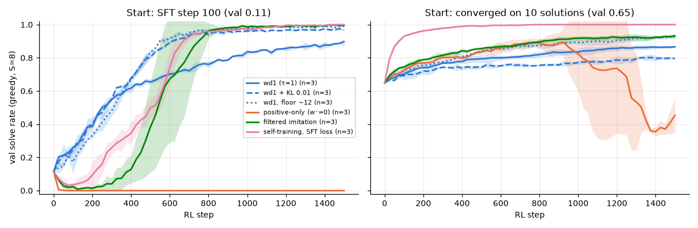

# 3.1g Do the better variants survive a different starting model?

**Goal:** follow-up added after 3.1d, not in the original spec. From the phase 2 start (SFT step 120) four variants beat plain wd1 and did not collapse: filtered imitation and self-training with the SFT loss (3.2), wd1 with a floored negative term (3.1c) and wd1 with a small KL penalty to the start (3.2b). 3.1d showed that results from that one start do not carry over: positive-only at τ = 1 goes to 0 from SFT step 100 and collapses late from the model converged on 10 solutions. Rerun the four variants from those two starts.

**Prediction** (written before the runs):
- From SFT step 100 (val 0.11, 1–2% valid rollouts):
  - Filtered imitation and self-training do not collapse, because they give no weight to invalid rollouts, and end at 0.95 or more.
  - wd1 + KL 0.01 ends below plain wd1 (0.88), between 0.6 and 0.88: the KL ties it to a very weak start.
  - wd1 with floor −12 behaves like wd1 early (its rollouts start above the floor) and ends at 0.9 or more.
- From the model converged on 10 solutions (val 0.65, sharp):
  - Filtered imitation and self-training end at 0.9 or more on test with no late collapse.
  - wd1 + KL 0.01 ends within 0.05 of plain wd1 (0.79).
  - wd1 with floor −12 is unstable: many of its rollouts are below the floor from the start, where the objective acts like positive-only at τ = 1. In at least one seed the final val is more than 0.1 below its best.

**Command**
```
bash scripts/run_phase3.sh 3.1g ~/dllm-cache/venv/bin/python
PYTHONPATH=src python -m phase3.analysis 3.1g
```

- Config: `configs/phase3.yaml`; objectives `filtered`, `self_diffusion`, wd1 with `rl.ref_kl=0.01`, wd1 with `floor=-12`; starts SFT step 100 and the 10-solution model; seeds 0–2, 1500 steps. wd1 and positive-only from the same starts are the 3.1d runs.
- Code: as in 3.1c, 3.2 and 3.2b.
- Hardware: Apple M5 24 GB, macOS 27.0.1, Python 3.12.13, torch 2.15.0, MPS, fp32. Seeds 0–2, 1500 steps.
- Wall-clock: 24 runs in 61 min, three at a time.
- Results: `results/phase3/3.1g/` (`curves.csv`, `runs.csv`, `summary.csv`, `other_starts.png`).

## Outcome



Final test solve rate, mean ± std over 3 seeds. The wd1 and positive-only rows are the 3.1d runs; the middle column repeats 3.1b, 3.1c, 3.2 and 3.2b.

| Objective | from SFT step 100 (val 0.11) | from SFT step 120 (val 0.42) | from the 10-solution model (val 0.65) |
|---|---|---|---|
| self-training with the SFT loss | 0.999 ± 0.001 | 0.999 ± 0.001 | 1.000 ± 0.000 |
| filtered imitation | 0.996 ± 0.001 | 0.997 ± 0.001 | 0.888 ± 0.011 |
| wd1, floor −12 | 0.989 ± 0.003 | 0.991 ± 0.002 | 0.890 ± 0.020 |
| wd1 + KL 0.01 | 0.982 ± 0.002 | 0.976 ± 0.005 | 0.728 ± 0.006 |
| wd1 | 0.879 ± 0.004 | 0.860 ± 0.020 | 0.791 ± 0.011 |
| positive-only (τ = 1) | 0.000 | 0.996 ± 0.004 | 0.480 ± 0.100 |

Prediction check, from SFT step 100:
- **Filtered imitation and self-training "do not collapse and end at 0.95 or more": half right.** They end at 0.996 and 0.999, but both first fall to a val solve rate of 0.01–0.03 (steps 75–200) before climbing. Giving no weight to invalid rollouts did not prevent an early dip from this very weak start. Unlike positive-only, they recover in every seed.
- **wd1 + KL 0.01 "ends below plain wd1, between 0.6 and 0.88": wrong.** It ends at 0.982, ten points above plain wd1.
- **wd1 with floor −12 "ends at 0.9 or more": right** (0.989).

From the model converged on 10 solutions:
- **Filtered imitation and self-training "0.9 or more on test, no late collapse": right for self-training (1.000), just short for filtered imitation (0.888).** Neither collapses.
- **wd1 + KL 0.01 "within 0.05 of plain wd1": slightly wrong.** It is 6 points below (0.728 against 0.791). Tying the model to a weak starting point costs something here.
- **wd1 with floor −12 "unstable": wrong.** It is stable in all 3 seeds (largest drop from its best val: 0.003) and ends at 0.890.

**Shows:**
- Self-training with the SFT loss on the model's own valid rollouts reaches about 100% from all three starts. It is the only objective here that uses every valid rollout, including those of groups whose rewards are all equal, and from the sharp 10-solution model that is 99% of the groups.
- The floored wd1 is the most robust of the wd1 variants: 0.99, 0.99, 0.89, never unstable.
- A KL penalty to the start helps when the start is an unfinished model (0.98) and hurts when it is a converged weak one (0.73).
- Plain wd1 is never the best and never fails. Positive-only at τ = 1 is the only objective that fails outright.

**Does not show:** that self-training is the better method in general. It works here because a valid rollout is always a *correct* answer and valid rollouts exist from the start. With a reward that can be satisfied by wrong answers, or one that is almost never satisfied, it would have nothing good to imitate. One task, three starts, 3 seeds.
