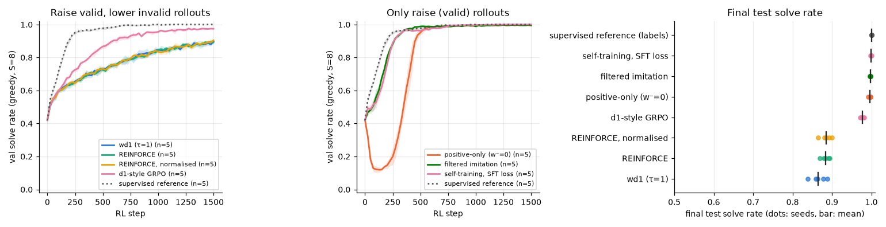

# 3.2 wd1 next to simpler objectives

**Goal:** find out whether what we saw for wd1 and positive-only is specific to them or shared by other objectives. All methods are hand-written and use the same rollouts, the same one-step likelihood estimate and the same budget (rollouts, gradient steps, learning rate).

| Method | Loss | Uses labels |
|---|---|---|
| wd1 (τ = 1) | Σ (w⁻ − w⁺)·log p̂ with softmax weights | no |
| positive-only (τ = 1) | −Σ w⁺·log p̂ | no |
| REINFORCE | −Σ A·log p̂, A = r − group mean (linear instead of softmax weights) | no |
| REINFORCE, normalised | the same with A divided by the group std | no |
| filtered imitation | −mean of log p̂ over the valid rollouts of a group (the τ → 0 limit of positive-only) | no |
| self-training with the SFT loss | masked-diffusion loss on the model's own valid rollouts, all groups | no |
| d1-style GRPO | clipped per-cell ratio against the pre-update policy (ε = 0.5), KL to the frozen start (0.04); adapted from the d1 trainer shipped in the wd1 repository | no |
| supervised reference | masked-diffusion loss on the true solutions of the same puzzles | **yes** |

**Prediction** (written before the runs):
- The methods that only push valid rollouts up (filtered imitation, self-training) do not collapse (lowest val at least 0.35) and end at 0.97 or more. They beat the "contrast" methods (wd1, REINFORCE, GRPO) at this horizon.
- REINFORCE, with or without normalisation, behaves like wd1: no dip, final test solve rate within 0.03 of wd1.
- GRPO: no dip, final within 0.05 of wd1.
- The supervised reference reaches 0.99 within 500 steps and is the fastest of all.

**Command**
```
bash scripts/run_phase3.sh 3.2 ~/dllm-cache/venv/bin/python
PYTHONPATH=src python -m phase3.analysis 3.2
```

- Config: `configs/phase3.yaml` (`rl.objective`, `rl.objective_defaults`), seeds 0–4, standard horizon.
- Code: `src/phase3/objectives.py`, `src/phase3/rl.py`. Sign tests for every objective: `tests/test_objectives_sign.py`.
- Hardware: Apple M5 24 GB, macOS 27.0.1, Python 3.12.13, torch 2.15.0, MPS, fp32. Seeds 0–4, 1500 steps.
- Wall-clock: 2 h 10 min for the 34 new runs, three at a time, while the 3.4b runs were using the CPU. That is longer than planned (about 1 h) and over the 2 h guideline for a single launch; the CPU jobs slowed the GPU runs. The wd1 and positive-only runs for seeds 0–2 are reused from 3.1b.
- Results: `results/phase3/3.2/` (`curves.csv`, `runs.csv`, `summary.csv`, `per_seed.csv`, `objectives.png`).

## Outcome



Mean ± std over 5 seeds, 1500 steps, sorted by test solve rate:

| Method | final test | test with one unmasking step | lowest val | first val ≥ 0.7 (median step) |
|---|---|---|---|---|
| supervised reference (labels) | 1.000 ± 0.000 | 0.736 | 0.42 (start) | 100 |
| self-training with the SFT loss | 0.999 ± 0.001 | 0.725 | 0.42 (start) | 200 |
| filtered imitation | 0.997 ± 0.001 | 0.567 | 0.42 (start) | 175 |
| positive-only (τ = 1) | 0.996 ± 0.003 | 0.579 | 0.11 (step 100) | 400 |
| d1-style GRPO | 0.977 ± 0.005 | 0.100 | 0.42 (start) | 225 |
| REINFORCE, normalised | 0.885 ± 0.013 | 0.080 | 0.42 (start) | 350 |
| REINFORCE | 0.884 ± 0.010 | 0.081 | 0.42 (start) | 400 |
| wd1 (τ = 1) | 0.865 ± 0.019 | 0.082 | 0.42 (start) | 425 |

Prediction check:
- **"Methods that only push valid rollouts up do not collapse and end at 0.97 or more, ahead of the contrast methods": right.** Filtered imitation and self-training never dip and end at 0.997 and 0.999. Self-training with the SFT loss is within 0.001 of training on the true solutions.
- **"REINFORCE behaves like wd1": right.** Its val curve lies on wd1's, with or without normalisation, and it ends within 0.02 of wd1 on test.
- **"GRPO ends within 0.05 of wd1": wrong.** GRPO ends 11 points above wd1 and 9 above REINFORCE, in all 5 seeds.
- **"The supervised reference reaches 0.99 within 500 steps": slightly optimistic.** 0.977 at step 500, 1.000 at step 1000. It is the fastest.

What the logs say about GRPO (observations, tested in 3.2b):
- The clipping was never active: the share of clipped cells is 0.00 at every evaluation. With the ratio close to 1, the GRPO policy term is REINFORCE's.
- What is left is the KL penalty towards the frozen start (weight 0.04). Late in training the estimated log-likelihood of GRPO's valid rollouts is −7.9, against −12.0 for REINFORCE and −11.9 for wd1, and 23% of its groups still carry signal against 11%.

**Shows:** on this task wd1's result is the result of the "raise valid, lower invalid" family: plain REINFORCE gives the same curve, so the softmax weighting is not what matters. Methods that only imitate their own valid rollouts with selective weights are faster, do not collapse and get to about 100% without labels. The one contrast method that does clearly better carries a KL term to the starting model.
**Does not show:** that imitation beats wd1 in general. Here valid rollouts are plentiful from the start (about 1 in 3) and a valid grid is always a correct one; with sparse or noisy rewards the picture may differ. Which part of GRPO helps is 3.2b.
