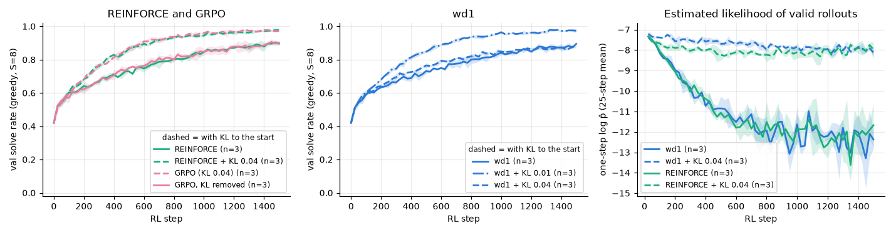

# 3.2b Why did GRPO do better than wd1 and REINFORCE? The KL term to the starting model

**Goal:** follow-up added after 3.2, not in the original spec. In 3.2, d1-style GRPO ended at 0.977 test against 0.884 for REINFORCE and 0.865 for wd1. Its clipping was never active, so the candidate explanation is its KL penalty towards the frozen starting model. This is also the "no KL/reference term" hypothesis from phase 2. (3.1f tests the other way a reference can enter, through the sampling, which is what the upstream wd1 code does.)

Arms, all at 1500 steps, seeds 0–2:

| Arm | What it tests |
|---|---|
| GRPO with KL weight 0 | remove the KL term from GRPO |
| REINFORCE + KL (weight 0.04) | add the same per-cell KL estimate to REINFORCE |
| wd1 + KL (weights 0.01 and 0.04) | add it to wd1. Not part of the wd1 paper or code |

The KL estimate is the one in the d1 GRPO trainer: exp(d) − d − 1 with d = log p_ref − log p for each cell of each rollout, under the same prompt mask. For the weighted objectives it is summed over the cells and rollouts of a kept group and added with weight `rl.ref_kl`.

**Prediction** (written before the runs):
- GRPO without KL falls back to REINFORCE's level: 0.86–0.91 test.
- REINFORCE + KL reaches GRPO's level: 0.95 or more.
- wd1 + KL ends at 0.93 or more for at least one of the two weights, and the estimated log-likelihood of its valid rollouts stays above −10 late in training (plain wd1: about −12).

**Command**
```
bash scripts/run_phase3.sh 3.2b ~/dllm-cache/venv/bin/python
PYTHONPATH=src python -m phase3.analysis 3.2b
```

- Config: `configs/phase3.yaml` (`rl.ref_kl`, `rl.objective_defaults.grpo.kl`).
- Code: `src/phase3/rl.py`, `src/phase3/objectives.py` (`grpo_loss`).
- Hardware: Apple M5 24 GB, macOS 27.0.1, Python 3.12.13, torch 2.15.0, MPS, fp32. Seeds 0–2, 1500 steps.
- Wall-clock: ran in the same launch as 3.1c (see there).
- Results: `results/phase3/3.2b/` (`curves.csv`, `runs.csv`, `summary.csv`, `kl_to_start.png`). The arms without changes (wd1, REINFORCE, GRPO with KL) are seeds 0–2 of 3.1b and 3.2.

## Outcome



Mean ± std over 3 seeds:

| Arm | final test | log p̂ of valid rollouts, last 250 steps | groups skipped, last 250 steps |
|---|---|---|---|
| GRPO (KL 0.04) | 0.978 ± 0.006 | −7.8 | 0.77 |
| REINFORCE + KL 0.04 | 0.978 ± 0.001 | −8.0 | 0.77 |
| wd1 + KL 0.01 | 0.976 ± 0.005 | −8.0 | 0.77 |
| wd1 + KL 0.04 | 0.896 ± 0.003 | −8.0 | 0.43 |
| REINFORCE | 0.880 ± 0.011 | −12.2 | 0.89 |
| GRPO, KL removed | 0.871 ± 0.006 | −12.3 | 0.90 |
| wd1 | 0.860 ± 0.020 | −12.5 | 0.90 |

Prediction check:
- **"GRPO without KL falls back to REINFORCE's level (0.86–0.91)": right.** 0.871.
- **"REINFORCE + KL reaches GRPO's level (0.95 or more)": right.** 0.978, equal to GRPO.
- **"wd1 + KL ends at 0.93 or more for at least one weight, valid likelihood above −10": right.** 0.976 with weight 0.01. With weight 0.04 the penalty is too strong for wd1's smaller coefficients: the model stays close to the start and ends at 0.896.

**Shows:** on this task the whole gap between GRPO and wd1/REINFORCE is the KL penalty towards the starting model. With it the likelihood of the model's own valid rollouts stops drifting down and the three objectives end at 0.98; without it they end at 0.86–0.88. This supports the phase 2 guess that the missing reference term was holding wd1 back.
**Does not show:** that wd1 needs a KL term at scale, or what the upstream wd1 would do: its reference enters through the sampling, not the loss (3.1f). The KL weight needed tuning per objective (0.01 worked for wd1, 0.04 did not), and only two values were tried.
