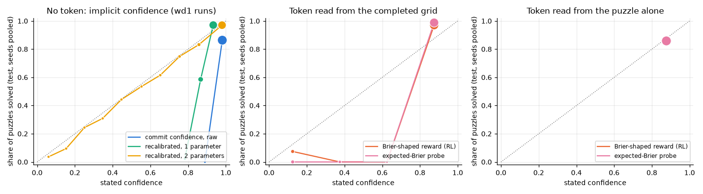

# 3.3b The confidence token on a frozen denoiser

**Goal:** follow-up added after 3.3, not in the original spec. In 3.3 the confidence token was trained while the grid policy was improving and with wd1's nearly flat weights, and it failed. Here the denoiser is frozen (the wd1-tuned checkpoints from 3.1b, test solve rate 0.84–0.88), so the solve rate cannot change and the token's target is stationary. Only the query vector and the confidence head are trained. The RL arm uses plain REINFORCE with the group-mean baseline on the Brier-shaped reward; the probe arm minimises the expected Brier loss.

**Prediction.** Written before the runs, but after a 40-step smoke test of the code, which showed both arms improving the Brier score from 0.10 to about 0.06–0.07 on val. The numbers below are therefore informed by that.
- probe, last: AUROC at least 0.95 and Brier at most 0.05, better than the 2-parameter recalibration of the implicit confidence (0.067).
- rl, last: AUROC at least 0.90 and Brier at most 0.06, with no collapse onto a single value in at least 2 of 3 seeds.
- first (both modes): AUROC between 0.60 and 0.80, Brier at most 0.02 below the base rate.

**Command**
```
bash scripts/run_phase3.sh 3.3b ~/dllm-cache/venv/bin/python
PYTHONPATH=src python -m phase3.analysis 3.3b
```

- Config: `configs/phase3.yaml` with `rl.objective=reinforce`; `--freeze`; init = `~/dllm-cache/phase3/3.1b/ckpt/wd1_beta1_tau1_seed{s}/final.pt` for seed s; 1500 steps; head lr 1e-3.
- Code: `src/phase3/conf_token.py` (`--freeze`).
- Hardware: Apple M5 24 GB, macOS 27.0.1, Python 3.12.13, torch 2.15.0, MPS, fp32. Seeds 0–2, each on the wd1 checkpoint of the same seed; 1500 steps.
- Wall-clock: 12 runs in 34 min, three at a time (7–9 min each).
- Results: `results/phase3/3.3b/` (one CSV, JSON and `_test.csv` per run, `runs.csv`, `summary.csv`, `calibration.png`). The implicit-confidence baseline is 3.3's, on the same checkpoints.

## Outcome



Test set, mean ± std over 3 seeds. The denoiser is frozen, so every row has the same solve rate (0.86) and the same implicit confidence as the 3.3 baseline. Always stating the base rate would score a Brier of 0.12.

| Confidence | Brier | ECE | AUROC |
|---|---|---|---|
| implicit (commit confidence), raw | 0.128 ± 0.018 | 0.121 | 0.919 |
| implicit, recalibrated with 2 parameters | 0.067 ± 0.005 | 0.020 | 0.919 |
| token from the completed grid, probe | **0.032 ± 0.007** | 0.135 | 0.980 ± 0.018 |
| token from the completed grid, RL (REINFORCE, Brier reward) | 0.047 ± 0.009 | 0.127 | 0.932 ± 0.003 |
| token from the puzzle alone, probe | 0.121 ± 0.015 | 0.017 | 0.658 ± 0.084 |
| token from the puzzle alone, RL | 0.121 ± 0.015 | 0.017 | 0.577 ± 0.005 |

Prediction check:
- **probe, last "AUROC at least 0.95, Brier at most 0.05, better than the recalibrated implicit confidence": right.** 0.980, 0.032, against 0.067.
- **rl, last "AUROC at least 0.90, Brier at most 0.06, no collapse in at least 2 of 3 seeds": right.** 0.932, 0.047, no collapse in any seed. It states 0.875 for 99% of the solved grids and 0.125 or 0.375 for 79% of the unsolved ones.
- **first "AUROC 0.60–0.80, Brier at most 0.02 below the base rate": right on Brier, half right on AUROC.** Both modes end up always stating 0.875, which is the base rate; the Brier score is the base rate's (0.121) and the ECE is tiny for that reason. The probe's AUROC is 0.58–0.75, the RL token's 0.57–0.58.
- The ECE of the `last` tokens (0.13) looks bad only because of the four-value grid: 0.875 is stated for grids that are valid 97% of the time. The Brier score is the fairer number here.

**Shows:** with a stationary target, a stated-confidence token trained from the Brier-shaped reward alone becomes a good verifier of the model's own grid (AUROC 0.93, Brier 0.047), and the exact-gradient probe a better one (0.98, 0.032). Both beat the best post-hoc recalibration of the model's implicit confidence. The two problems that sank 3.3, a moving target and flat weights, were the problems.
**Does not show:** that the token learns anything *before* the answer: from the puzzle alone it states the base rate. And "is this grid valid" is a check the architecture can do by looking at the grid, so this is self-verification of an easy kind, not uncertainty about a reasoning process. RL was consistently a little worse than the probe, as expected from a sampled gradient.
