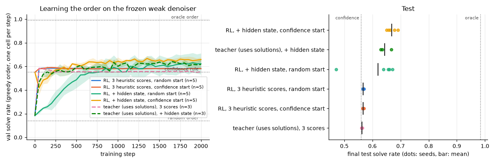

# 3.4b Learning the unmasking order with RL on a frozen denoiser

**Goal:** 3.4a showed that some order solves 0.98 of the test puzzles with the weak denoiser, against 0.56 for the `confidence` rule. Can a small policy trained with RL on the validity reward, without ever seeing a solution, recover part of that gap?

Setup: the denoiser (SFT step 120) is frozen. One cell is committed per step with the denoiser's greedy value. A policy head scores every masked cell and a cell is sampled from the softmax over the scores (greedy at evaluation). Training is REINFORCE with the group-mean baseline, 32 puzzles × 8 episodes per step. The log-probability of an order is exact, so no likelihood proxy is needed.

| Variant | Inputs per cell | Start |
|---|---|---|
| `probs`, zero init | confidence, margin, 1 − entropy | uniform random order (0.14) |
| `probs`, confidence init | the same | exactly the confidence rule (0.56) |
| `hidden`, zero init | the same + the denoiser's final hidden state | uniform random order |
| `hidden`, confidence init | the same | exactly the confidence rule |
| oracle teacher, `probs` and `hidden` | as above | supervised with the solution: a ceiling for what each input set can express, not a method |

**Prediction** (written before any training run, including pilots):
- `probs`, zero init: learns quickly, ends near the confidence rule (0.50–0.60 test), not clearly above it. The three inputs *are* the heuristics, and they probably cannot tell a confident wrong cell from a confident right one.
- `probs`, confidence init: 0.56–0.62, a small gain at most.
- `hidden`: clearly above the confidence rule, 0.65–0.80, far below the oracle's 0.98.
- Oracle teacher: about 0.60 with `probs` and about 0.85 with `hidden`.

**Command**
```
bash scripts/run_phase3.sh 3.4b ~/dllm-cache/venv/bin/python
PYTHONPATH=src python -m phase3.analysis 3.4b
```

- Config: `configs/phase3.yaml` (`order_policy:`). Learning rate chosen on val in a one-seed pilot (see Outcome).
- Code: `src/phase3/order_policy.py`. Tests: `tests/test_order_policy.py`.

## Transfer check (added after the training runs, before running it)

Apply the trained policies (best-val checkpoints, no further training) to denoisers they were not trained on: the earlier and later SFT snapshots (steps 100 and 130) and the three wd1-tuned denoisers from 3.1b. For each denoiser also report the confidence rule and the oracle.

**Prediction:** the `probs` policy transfers, since it has learned the confidence rule. The `hidden` policies do not: on a denoiser whose hidden states have moved (the RL-tuned ones most of all) they are at or below the confidence rule.

```
PYTHONPATH=src python -m phase3.order_policy transfer --denoisers sft100=~/dllm-cache/phase2/sft/step_000100.pt \
  sft120=~/dllm-cache/phase2/sft/sft_weak.pt sft130=~/dllm-cache/phase2/sft/step_000130.pt \
  wd1_seed0=~/dllm-cache/phase3/3.1b/ckpt/wd1_beta1_tau1_seed0/final.pt \
  wd1_seed1=~/dllm-cache/phase3/3.1b/ckpt/wd1_beta1_tau1_seed1/final.pt \
  wd1_seed2=~/dllm-cache/phase3/3.1b/ckpt/wd1_beta1_tau1_seed2/final.pt
```

## Run details

- Pilot (seed 0 only, `results/phase3/3.4b/pilot/`): with the 3 heuristic scores every learning rate in {1e-3, 3e-3, 1e-2} reached val 0.58–0.59 within 150–300 steps; with the hidden state 1e-2 was best at 1000 steps (val 0.61, against 0.56 for 3e-2) and still rising. Chosen on val: lr 3e-3 for `probs`, 1e-2 for `hidden`, 2000 steps for all.
- Hardware: Apple M5 24 GB, macOS 27.0.1, Python 3.12.13, torch 2.15.0, fp32. Seeds 0–4 for the RL variants, 0–2 for the oracle teacher.
- **Mixed devices.** 14 runs finished on MPS (about 13 min each, sharing the GPU). The other 12 (seeds 3–4 of three variants and all six teacher runs) ran on CPU to free the GPU, at about 77 min each under heavy contention. The device is recorded per run in `runs.csv`. It changes the random stream, so it acts like a different seed; it is confounded with the seed, not with the variant, except that all teacher runs are CPU runs.
- Results: `results/phase3/3.4b/` (one CSV and JSON per run, `runs.csv`, `summary.csv`, `order_policy.png`, `transfer.csv`, `transfer_summary.csv`). Policy checkpoints stay local.

## Outcome



Test solve rate on the frozen weak denoiser, one cell per step, mean ± std over seeds:

| Order | test solve rate | steps agreeing with the confidence rule |
|---|---|---|
| random | 0.144 | |
| confidence rule | 0.560 | 100% |
| RL, 3 heuristic scores, random start | 0.567 ± 0.002 | 96% |
| RL, 3 heuristic scores, confidence start | 0.567 ± 0.001 | 96% |
| RL, + hidden state, random start | 0.619 ± 0.084 | 73% |
| RL, + hidden state, confidence start | 0.668 ± 0.016 | 77% |
| teacher (uses solutions), 3 scores | 0.562 ± 0.001 | 95% |
| teacher (uses solutions), + hidden state | 0.644 ± 0.021 | 69% |
| oracle | 0.984 | |

Prediction check:
- **`probs`, random start "ends near the confidence rule, not clearly above": right.** From a uniform random order it reaches 0.58 val within 50–100 steps and stays there. It has rediscovered the confidence rule (96% of its choices are the same) and is 0.7 points above it.
- **`probs`, confidence start "0.56–0.62": right.** 0.567, the same endpoint.
- **`hidden` "clearly above the confidence rule, 0.65–0.80": right at the low end.** 0.668 from the confidence start, 11 points above the rule. From a random start four seeds reach 0.64–0.67 and one is stuck at 0.47.
- **Oracle teacher "about 0.60 with `probs`, about 0.85 with `hidden`": wrong for `hidden`.** Trained with the solutions, the same head reaches only 0.644, no better than RL without them. (Two of the three teacher runs were still improving at step 2000.)

Transfer of the trained policies to other denoisers (no retraining, test solve rate):

| Denoiser | confidence rule | policy, 3 scores | policy, + hidden state (confidence start) | oracle |
|---|---|---|---|---|
| SFT step 100 | 0.169 | 0.170 | 0.097 | 0.867 |
| SFT step 120 (trained on) | 0.560 | 0.566 | 0.663 | 0.984 |
| SFT step 130 | 0.681 | 0.683 | 0.656 | 0.992 |
| wd1-tuned, 3 runs from 3.1b | 0.919–0.956 | 0.921–0.959 | 0.893–0.927 | 1.000 |

- **Transfer prediction: right.** The 3-score policy is the confidence rule on every denoiser. The hidden-state policy is below the confidence rule on every denoiser it was not trained on, even the one only 10 SFT steps away.

**Shows:** RL on the validity reward alone finds the confidence rule from scratch in about 50 steps, and with access to the denoiser's hidden state it finds an order 11 points better than that rule. That is about a quarter of the gap to the oracle (0.56 → 0.67 of a possible 0.98). The gain is tied to the exact denoiser it was trained on.
**Does not show:** that the rest of the gap can be learned. A head trained with the solutions does no better, so the limit here looks like what these inputs and this small head can express about which prediction is right, not the RL signal. Larger heads, more training or other inputs were not tried. The oracle's 0.98 needs the answer.
