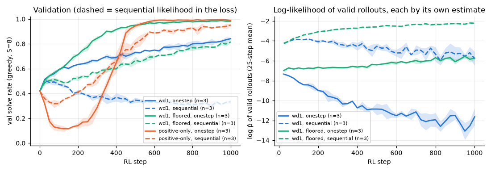

# 3.6a Is the likelihood proxy the problem? wd1 with the sequential likelihood

**Goal:** robustness check added after the phase 3 summary. Every claim about wd1 "pushing down the likelihood of its own valid rollouts" was read through the one-step mean-field estimate, which phase 2 found to be biased low by about 3 nats. Replace it in the loss by the fixed-order sequential likelihood (16 forward passes, the estimate phase 2 used as the reference) and see whether the story changes.

Arms, 3 seeds, **1000 steps** (the sequential likelihood costs about 1 s per step, so the horizon is shorter than the standard 1500; comparisons with the one-step runs are made on the val curves at matched steps):

| Arm | Likelihood in the loss |
|---|---|
| wd1 (τ = 1) | sequential |
| wd1 with a floor on the negative term | sequential; floor at −9, i.e. the one-step floor of −12 shifted by the 3-nat bias |
| positive-only (τ = 1) | sequential |

The diagnostics `logp_valid` / `logp_invalid` are then sequential log-likelihoods; `pred_entropy` is not logged.

**Prediction** (written before the runs):
- wd1 with the sequential likelihood is still slow: val at step 1000 within 0.05 of the one-step wd1 (0.843), and the sequential log-likelihood of its valid rollouts still falls by at least 3 nats over training. The drag belongs to the objective, not to the proxy.
- The floored wd1 reaches a val solve rate of 0.95 or more by step 1000, as its one-step version did.
- Positive-only still collapses early (lowest val below 0.2) and recovers to 0.95 or more by step 1000.

**Command**
```
bash scripts/run_phase3.sh 3.6a ~/dllm-cache/venv/bin/python
PYTHONPATH=src python -m phase3.analysis 3.6a
```

- Config: `configs/phase3.yaml` with `rl.likelihood=sequential`, `rl.max_rl_steps=1000`; floor −9.
- Code: `src/phase3/rl.py` (`sequential_cell_logp`). Test against phase 2's `sequential_loglik`: `tests/test_objectives_sign.py`.
- Hardware: Apple M5, 24 GB, MPS, float32, torch 2.15.0. Seeds 0–2. Wall clock 26–41 min per run, three at a time (under contention with the 3.6b runs for the first part); the whole experiment took about 1 h 50 min.
- Results: `results/phase3/3.6a/` (`curves.csv`, `runs.csv`, `summary.csv`, `sequential_likelihood.png`).

## Outcome



Mean ± std over 3 seeds, val solve rate at step 1000 (the one-step rows are the 3.1b/3.1c runs at the same step):

| Arm | likelihood in the loss | val at 1000 | lowest val | change in log p̂ of valid rollouts (steps 1–50 → 751–1000) | final test |
|---|---|---|---|---|---|
| wd1 | one-step | 0.842 ± 0.010 | 0.42 | −4.7 | |
| wd1 | sequential | 0.333 ± 0.016 | 0.28 | −1.2 | 0.336 ± 0.014 |
| wd1, floored | one-step (−12) | 0.982 ± 0.005 | 0.42 | +1.0 | |
| wd1, floored | sequential (−9) | 0.815 ± 0.008 | 0.42 | +1.8 | 0.821 ± 0.013 |
| positive-only | one-step | 0.989 ± 0.004 | 0.11 | +1.9 | |
| positive-only | sequential | 0.952 ± 0.010 | 0.30 | +2.3 | 0.927 ± 0.007 |

Prediction check:
- **"wd1 is still slow, val at 1000 within 0.05 of 0.843, valid log-likelihood falls by at least 3 nats": wrong on both counts.** wd1 does not climb slowly, it gets worse than its start: val 0.42 → 0.33 in all three seeds, after a short rise to about 0.5. The sequential log-likelihood of its valid rollouts falls by 1.2 nats, not 3.
- **"The floored wd1 reaches 0.95 or more by step 1000": wrong.** 0.815, still rising. The floor again turns wd1 from a bad run into a working one (+0.48 over unfloored), but it is slower than its one-step version.
- **"Positive-only collapses below 0.2 and recovers to 0.95 or more": half right.** It recovers to 0.952; the dip is shallower (lowest val 0.30 against 0.11).

**Shows:** the ranking of the three arms does not depend on the likelihood estimate (positive-only > floored wd1 > wd1 with both), and the unbounded negative term is still what hurts wd1: with the sequential estimate it hurts more, not less. So "wd1 pushes down its own valid rollouts" was not an artefact of the one-step proxy. Every arm is slower or worse with the sequential estimate in the loss.
**Does not show:** why the sequential estimate is worse. Not tested; candidates are (a) it scores the grid in a fixed row-major order while the sampler fills cells in confidence order, so the loss trains a path the sampler does not use, (b) the floor of −9 is a guess (−12 shifted by the 3-nat bias) and was not tuned, (c) 16 chained forward passes change the gradient scale under the same clipping. Horizon is 1000 steps, not 1500, and the one-step comparison runs were not rerun.
