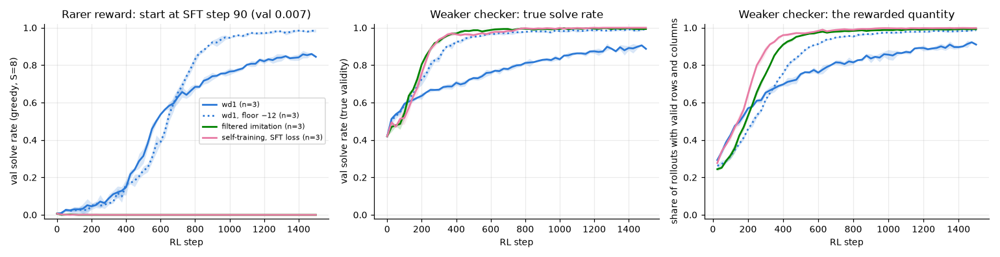

# 3.6b A rarer reward and a weaker checker

**Goal:** robustness check added after the phase 3 summary. Two features of the toy favour the objectives that imitate valid rollouts: valid rollouts exist from the start, and a valid grid is always a correct one. Weaken each in turn.

| Part | Change | Start |
|---|---|---|
| rarer reward | start from SFT step 90, val solve rate 0.007 (step 100, used in 3.1d/3.1g, had 0.11) | SFT step 90 |
| weaker checker | reward `lenient`: 1 if rows and columns are valid and the givens kept; the 2×2 boxes are ignored. A Latin square that breaks the boxes is rewarded. Evaluation stays the true solve rate | SFT step 120 (phase 2 start) |

Arms in both parts, 3 seeds, 1500 steps: wd1 (τ = 1), wd1 with floor −12, filtered imitation, self-training with the SFT loss.

**Prediction** (written before the runs):
- Rarer reward: with about 1 valid rollout in 150 at the start, all four still learn. Self-training and filtered imitation dip towards 0 first and end at 0.95 or more; the floored wd1 ends at 0.9 or more; plain wd1 ends between 0.6 and 0.9.
- Weaker checker: the lenient reward is driven to 0.95 or more by every arm, but the true solve rate ends lower than with the strict reward in every arm. The gap is largest for the two imitation arms (at least 5 points below their strict-reward results of 0.997 and 0.999), because they imitate rewarded grids whether or not the boxes are right. No arm's true solve rate falls below its start (0.48).

**Command**
```
bash scripts/run_phase3.sh 3.6b ~/dllm-cache/venv/bin/python
PYTHONPATH=src python -m phase3.analysis 3.6b
```

- Config: `configs/phase3.yaml`; `rl.reward=lenient` for the second part; `--init ~/dllm-cache/phase2/sft/step_000090.pt --tag _sft90` for the first.
- Code: `src/phase3/rewards.py` (`lenient`). Test: `tests/test_rewards.py`.
- Hardware: Apple M5, 24 GB, MPS, float32, torch 2.15.0. Seeds 0–2.
- Results: `results/phase3/3.6b/` (`curves.csv`, `runs.csv`, `summary.csv`, `rarer_reward_weaker_checker.png`).
- Wall clock: 2.5–9.5 min per run, three at a time (the first launch shared the machine with 3.6a).

## Outcome



Test solve rate (true validity) after 1500 steps, mean ± std over 3 seeds. The strict-reward column is the same arm from the phase 2 start (3.1b, 3.1c, 3.2, 3.1g).

| Arm | strict reward, step-120 start | rarer reward (step-90 start) | lowest val | weaker checker: true solve rate | weaker checker: rewarded share of rollouts, last 250 steps |
|---|---|---|---|---|---|
| wd1 | 0.860 | 0.836 ± 0.009 | 0.006 | 0.882 ± 0.004 | 0.90 |
| wd1, floor −12 | 0.991 | 0.987 ± 0.004 | 0.006 | 0.989 ± 0.002 | 0.98 |
| filtered imitation | 0.998 | 0.000 ± 0.000 | 0.000 | 0.996 ± 0.001 | 0.99 |
| self-training, SFT loss | 0.999 | 0.001 ± 0.000 | 0.000 | 0.999 ± 0.001 | 1.00 |

Prediction check, rarer reward:
- **"All four still learn; the two imitation arms dip and end at 0.95 or more": wrong.** Both imitation arms never leave zero, in all three seeds. The start was also harsher than assumed: about 1 sampled rollout in 700 is valid in the first 100 steps (the "1 in 150" was the greedy val solve rate), so 99% of groups contain no valid rollout. For the imitation arms the share of valid rollouts then falls further (0.0010 → 0.0002).
- **"Floored wd1 ends at 0.9 or more": right** (0.987).
- **"Plain wd1 ends between 0.6 and 0.9": right** (0.836).

Prediction check, weaker checker:
- **"The lenient reward is driven to 0.95 or more by every arm": right for three arms, wrong for wd1** (0.90, still rising, the same slowness it has with the strict reward).
- **"The true solve rate ends lower than with the strict reward in every arm, by at least 5 points for the imitation arms": wrong.** The differences are 0.000 to 0.002 for three arms, and wd1 is 0.02 *higher* with the lenient reward (0.882 against 0.860). Rewarding Latin squares that break the boxes cost nothing measurable.
- **"No arm falls below its start": right.**

**Shows:** the ranking from the phase 3 summary ("the plainest recipe, training on your own valid attempts, is best") holds only where valid attempts are not too rare. From a start where they are about 1 in 700, both imitation arms learn nothing and the two wd1 variants reach 0.84 and 0.99: the order of the four arms flips. Dropping the box rule from the reward did not change any arm's true solve rate.
**Does not show:** why. Not tested: (i) the wd1 arms saw the same rare valid rollouts in the first steps (98.6% of groups skipped) and still climbed, so "the imitation arms had nothing to imitate" is at best part of the reason; the imitation arms use a different batch construction and loss scale and none of that was varied. (ii) The lenient result may only say that this model rarely produces grids with valid rows and columns but broken boxes; the share of such rollouts was not logged. One start, one learning rate, 3 seeds.

**Launch problem (kept for the record):** the first launch ran 15 of the 24 runs. In `scripts/run_phase3.sh` the argument lines of the plain wd1 runs ended in a blank, and `xargs -L 1` joins a line that ends in a blank with the next one; three merged commands per seed failed with `unrecognized arguments`. Fixed by stripping trailing blanks before `xargs`; the 9 missing runs (wd1 and floored wd1 from step 90, wd1 with the lenient reward) were run afterwards at commit `9c9de1c`, the other 15 at `d29d402`. The rerun's runner then ended with a shell syntax error after its last run, because the script file was edited (to add 3.6c) while it was executing; all 24 result files were complete and the analysis was run by hand.
