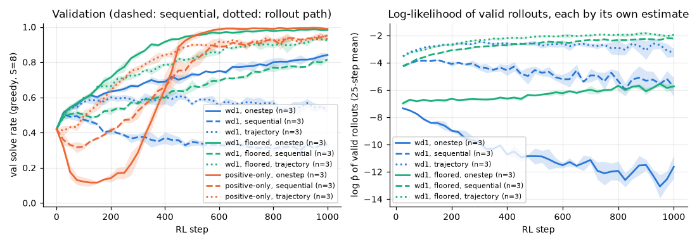

# 3.6c Is it the fixed order? wd1 with the likelihood along the rollout's own path

**Goal:** follow-up to [3.6a](../3.6a/README.md). There, putting the fixed-order (row-major) sequential likelihood in the loss made every arm slower and made wd1 worse than its start. Candidate reason (a) in that write-up: the loss scores a grid along a path (cell 1, 2, ..., 16) that the confidence-order sampler never uses. Two checks.

**Part 1, training.** Same three arms as 3.6a, 3 seeds, 1000 steps, with `rl.likelihood=trajectory`: each cell is scored with the input the sampler actually saw when it committed it (givens plus the cells committed at earlier sampler steps). This is the chain rule along the rollout's own path, one forward pass per sampler step (8), cells committed in the same step treated as independent, and the choice of order treated as fixed (no gradient through it).

| Arm | Likelihood in the loss |
|---|---|
| wd1 (τ = 1) | rollout path |
| wd1 with a floor on the negative term | rollout path; floor at −9, the same value as the sequential arm of 3.6a (not tuned) |
| positive-only (τ = 1) | rollout path |

**Part 2, evaluation only.** Take the final checkpoints of the one-step runs (3.1b/3.1c, 1500 steps) and of the sequential runs (3.6a, 1000 steps) and solve the test set two ways: the usual confidence order, and a fixed row-major order, one cell per step, greedy values. If the sequential loss trained "a path the sampler does not use", those models should be better along the row-major path than along the confidence path.

**Prediction** (written before the runs and before the evaluation):
- Part 1. If the order mismatch is the reason, the rollout-path likelihood should behave like the one-step one. wd1: val at step 1000 of 0.70 or more (sequential 0.333, one-step 0.842). Floored wd1: 0.90 or more (sequential 0.815, one-step 0.982). Positive-only: 0.95 or more, with an early dip below 0.3.
- Part 2. The models trained with the sequential likelihood solve at least 0.15 more of the test set in row-major order than in confidence order (8 steps); the models trained with the one-step likelihood do not (row-major no better than confidence order).

**Command**
```
bash scripts/run_phase3.sh 3.6c ~/dllm-cache/venv/bin/python
PYTHONPATH=src python -m phase3.fixed_order_eval
PYTHONPATH=src python -m phase3.analysis 3.6c
```

- Config: `configs/phase3.yaml` with `rl.likelihood=trajectory`, `rl.max_rl_steps=1000`; floor −9.
- Code: `src/phase3/rl.py` (`trajectory_cell_logp`), `src/phase3/fixed_order_eval.py`. Test that the path likelihood reduces to the one-step one when everything is committed in one step, and to the sequential one when cells are committed one per step in row-major order: `tests/test_objectives_sign.py`.
- Hardware: Apple M5, 24 GB, MPS, float32, torch 2.15.0. Seeds 0–2. Wall clock 15–20 min per run, three at a time; the whole experiment took 53 min. The evaluation of part 2 takes under a minute.
- Results: `results/phase3/3.6c/` (`curves.csv`, `runs.csv`, `summary.csv`, `fixed_order_eval.csv`, `rollout_path_likelihood.png`).
- The prediction was committed (`9c9de1c`) after a 50-step smoke test of the floored arm in a scratch cache (val 0.55 at step 50) and before any of the runs or the evaluation below.

## Outcome



**Part 1.** Val solve rate at step 1000, mean ± std over 3 seeds (one-step rows from 3.1b/3.1c, sequential rows from 3.6a):

| Arm | one-step | sequential (row-major) | rollout path | lowest val, rollout path | final test, rollout path |
|---|---|---|---|---|---|
| wd1 | 0.842 ± 0.010 | 0.333 ± 0.016 | 0.532 ± 0.019 | 0.42 | 0.548 ± 0.012 |
| wd1, floored | 0.982 ± 0.005 | 0.815 ± 0.008 | 0.925 ± 0.007 | 0.42 | 0.922 ± 0.016 |
| positive-only | 0.989 ± 0.004 | 0.952 ± 0.010 | 0.931 ± 0.003 | 0.41 | 0.936 ± 0.015 |

**Part 2.** Test solve rate of saved checkpoints, mean over 3 seeds (`fixed_order_eval.csv`). The one-step models have 1500 RL steps, the sequential ones 1000.

| Model | confidence order, 8 steps | confidence order, 16 steps | row-major order, 16 steps |
|---|---|---|---|
| start (SFT step 120) | 0.482 | 0.560 | 0.176 |
| wd1, one-step | 0.860 | 0.939 | 0.405 |
| wd1, sequential | 0.336 | 0.364 | 0.370 |
| wd1 floored, one-step | 0.991 | 0.997 | 0.677 |
| wd1 floored, sequential | 0.821 | 0.895 | 0.573 |
| positive-only, one-step | 0.996 | 0.999 | 0.838 |
| positive-only, sequential | 0.927 | 0.961 | 0.794 |

Prediction check:
- **"wd1 with the rollout-path likelihood reaches 0.70 or more": wrong.** 0.532. It is above the sequential version (+0.20) and no longer falls below its start, but it rises to about 0.6 in the first 150 steps and then drifts down, far from the one-step 0.842.
- **"Floored wd1 reaches 0.90 or more": right** (0.925; sequential 0.815).
- **"Positive-only reaches 0.95 or more with a dip below 0.3": wrong on both.** 0.931, and there is no dip at all (lowest val 0.41, the start is 0.42).
- **"Sequentially trained models solve at least 0.15 more in row-major order than in confidence order; one-step models do not": wrong for the first half, right for the second.** The largest difference is +0.03 (wd1, sequential: 0.370 against 0.336); the other two sequential models are worse in row-major order, like every one-step model. The sequential loss did not produce models that are good along its own path.

**Shows:** the order mismatch is at most part of the story. Scoring along the sampler's own path recovers some of what the row-major likelihood lost for the two wd1 arms (+0.20 and +0.11) and nothing for positive-only, and no arm gets back to its one-step result. Across the three estimates, plain wd1 is worst with either chain-rule likelihood and best with the crude one-step proxy; the floor helps with all three (+0.14, +0.48, +0.39). Positive-only's early collapse, a constant of phases 2 and 3, shrinks with the sequential estimate and disappears with the rollout-path one.
**Does not show:** why the one-step proxy trains better. Not tested: the gradient scale under clipping to norm 1 (8 or 16 chained passes against 1), the untuned floor of −9, and the fact that the one-step loss always trains the prediction from the bare puzzle, which is the hardest input and the one the sampler starts from. The one-step comparison runs were stopped at 1500 steps and compared at step 1000 on val only; 3 seeds; one learning rate.
