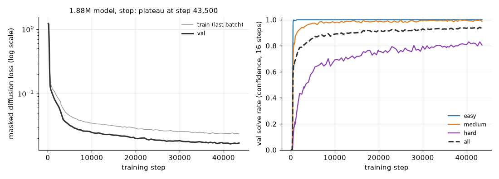
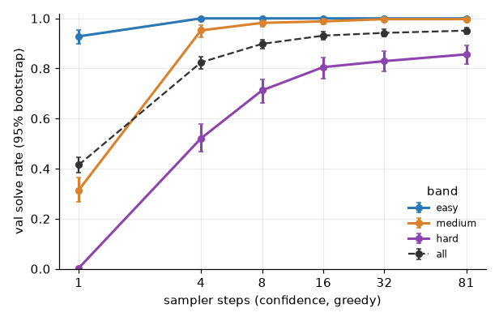

# 4.1 Model size check and masked diffusion training on 9×9

**Goal:** pick the model size by the rule fixed in the spec, then train that model to a plateau.

## Size check (done)

**Command**
```
bash scripts/run_phase4.sh size python     # size_small then size_medium, 20 minutes each, one after the other
```
- Config: `configs/phase4.yaml` (`sizes.small` = 4 layers, d 128, 809,737 parameters; `sizes.medium` = 6 layers, d 160, 1,876,489 parameters). Batch 256, AdamW lr 3e-4 with 500 warm-up steps then constant (phase 2 used a cosine; here the last step is not known in advance), dropout 0.1, seed 0.
- Evaluation: 1,002 val puzzles, `confidence` unmasking, 16 sampler steps, greedy.
- Hardware: Apple M5 (Mac17,3), 24 GB, macOS 27.0.1, Python 3.12.13, torch 2.15.0, MPS, fp32, nothing else on the GPU.
- Wall-clock: 20 min each (the budget), 40 min in total.
- Results: `results/phase4/sft/size_{small,medium}.{csv,json}`. Checkpoints local, `~/dllm-cache/phase4/sft/`.

| after 20 minutes | steps done | val loss | val solve: all | easy | medium | hard | hidden cells correct |
|---|---|---|---|---|---|---|---|
| 0.8M | 7,489 | 0.0563 | 0.829 | 1.000 | 0.958 | 0.530 | 0.922 |
| 1.86M | 2,971 | 0.0510 | 0.807 | 1.000 | 0.937 | 0.485 | 0.911 |

Paired bootstrap on the val puzzles, 1.86M minus 0.8M solve rate: −0.022 [−0.044, 0.000] overall, −0.045 [−0.108, 0.015] on the hard band.

**Reading against the rule.** The rule says: use 1.86M unless it is not better than 0.8M. The answer is mixed. At equal time the larger model has the lower val loss (by 9%) and a solve rate that is 2 points lower, with an interval that touches zero. At equal steps it is clearly ahead (its step 2,000 matches the small model's step 4,000 on every column), but each step costs 2.5 times as much (403 ms against 160 ms, evaluations included). The 1.86M model was chosen, because val loss is the quantity the plateau rule watches and it is ahead there; this is a judgement on an ambiguous outcome, not a clean pass of the rule. Neither model is at zero on the easy band, so the 6.3M model was not tried.

**Shows:** both sizes learn 9×9 Sudoku from 100k puzzles within minutes; after 20 minutes they solve all easy, about 95% of medium and about half of the hard val puzzles.
**Does not show:** which size is better at convergence (one seed, 20 minutes, neither run had flattened), nor anything about RL.

## Training to the plateau (done)

**Command**
```
SIZE=medium bash scripts/run_phase4.sh sft python      # repeat until it prints "finished"; each launch stops after 110 minutes
bash scripts/run_phase4.sh sft-report python           # curve, and solve rate per band x sampler steps on val
```
- Config: `configs/phase4.yaml`, `sizes.medium` (6 layers, d 160, 4 heads, 1,876,489 parameters; the spec and the text above call it "1.86M", the plot title rounds it to 1.88M). Same training settings as the size check, seed 0.
- The run continues the size-check run of the same model (same config and seed), so its first 2,971 steps are that run.
- Stop rule: val loss not improved by 1% over 5,000 steps, or 50,000 steps. **Stopped by the plateau rule at step 43,500** (best val loss 0.01645 at step 41,500; the best before step 38,500 was within 1% of it).
- Hardware and software as above. fp32, MPS. MPS is not bit-repeatable (see the regression guard in the spec).
- **Wall-clock: 4 h 58 min of training** (17,875 s, evaluations included, about 410 ms per step), in four launches: the 20-minute size check, then 110, 110 and 58 minutes. The spec had estimated 2 to 4 hours. The report command takes 1 minute.
- Results: `results/phase4/sft/sft.csv` (one row per evaluation), `sft.json`, `sft_training_curve.png`, `sft_solve_by_steps.{csv,png}`. Checkpoints every 500 steps, local only, in `~/dllm-cache/phase4/sft/sft/` (`final.pt` is step 43,500 and is the model used below and in 4.2).



| step | val loss | val solve: all | easy | medium | hard |
|---|---|---|---|---|---|
| 4,000 | 0.0362 | 0.828 | | | |
| 12,000 | 0.0239 | 0.887 | | | |
| 19,884 | 0.0200 | 0.916 | 1.000 | 0.982 | 0.767 |
| 35,566 | 0.0172 | 0.927 | 1.000 | 0.988 | 0.793 |
| 43,500 (final) | 0.0169 | 0.931 | 1.000 | 0.988 | 0.805 |

The solve rate moves by about ±0.01 from one evaluation to the next (hard band ±0.02), so the last rows are not distinguishable from each other.

**Solve rate per band × sampler steps** (final model, 1,002 val puzzles, `confidence`, greedy; 95% bootstrap interval on the hard band):

| sampler steps | all | easy | medium | hard | hard interval | seconds for 1,002 puzzles |
|---|---|---|---|---|---|---|
| 1 | 0.415 | 0.928 | 0.314 | 0.003 | [0.000, 0.009] | 0.5 |
| 4 | 0.824 | 1.000 | 0.952 | 0.521 | [0.467, 0.578] | 2.0 |
| 8 | 0.898 | 1.000 | 0.982 | 0.713 | [0.662, 0.757] | 3.7 |
| 16 | 0.931 | 1.000 | 0.988 | 0.805 | [0.760, 0.844] | 7.3 |
| 32 | 0.942 | 1.000 | 0.997 | 0.829 | [0.787, 0.868] | 14.8 |
| 81 | 0.951 | 1.000 | 0.997 | 0.856 | [0.817, 0.892] | 25.9 |



**Shows:** a 1.9M model trained for 5 hours on 100k generated puzzles solves all easy, 99% of medium and about 80% of hard val puzzles with 16 sampler steps. Unlike the converged 4×4 toy, which solved everything in one step, here the number of sampler steps matters a lot: one step solves 0.3% of the hard band, 81 steps 86%.
**Does not show:** that the model has converged in solve rate (val loss was still drifting down by under 1% per 5,000 steps when the rule stopped it); anything on the test set or about other unmasking strategies (step 4.2); what a larger model or more data would reach. One seed. The 14% of hard puzzles left unsolved at 81 steps were not examined.

**For step 4.3:** with the default sampler (16 steps) every band is above 0.7, so by the rule in the spec the task has to be made harder, not the model weaker. A budget of 4 steps puts the hard band at 0.52, inside the 0.2 to 0.7 window; larger k is the other option. The choice is made in 4.3.
