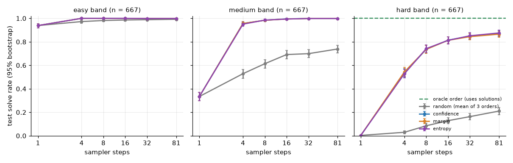
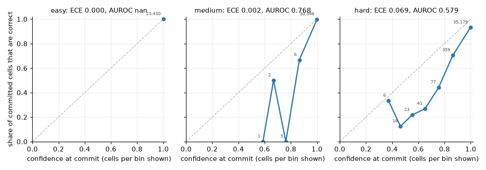

# 4.2 Sampler strategies, order headroom and calibration on 9×9

**Goal:** see whether the unmasking order and the number of sampler steps matter for the plateau model of 4.1 (on the converged 4×4 toy they did not), how much room a better order would have, and whether commit confidence predicts errors.

**Command**
```
PYTHONPATH=src python -m phase4.sampler_eval --size medium
```
- Config: `configs/phase4.yaml` (`sizes.medium`); model `~/dllm-cache/phase4/sft/sft/final.pt` (step 43,500 of the 4.1 run, 1,876,489 parameters).
- Data: the test split, 2,001 puzzles, 667 per band (easy k 30–40, medium 41–50, hard 51–56). First use of the test split in phase 4.
- Strategies `random`, `confidence`, `margin`, `entropy` × sampler steps {1, 4, 8, 16, 32, 81}, greedy. `random` is run with 3 order seeds and averaged; the others are deterministic given the model.
- Hardware: Apple M5 (Mac17,3), 24 GB, macOS 27.0.1, Python 3.12.13, torch 2.15.0, MPS, fp32. Seed 0 (and 1, 2 for the random orders). MPS is not bit-repeatable.
- Wall-clock: 10 min 51 s for everything.
- Results: `results/phase4/4.2/` (`strategies.csv`, `strategies_table.csv`, `strategies_paired_diff.csv`, `oracle_hard.json`, `calibration.csv`, `calibration_bins.csv`, two plots, `run.json`).

## Strategies × sampler steps (test solve rate)

| band | strategy | 1 | 4 | 8 | 16 | 32 | 81 |
|---|---|---|---|---|---|---|---|
| easy | confidence | 0.939 | 1.000 | 1.000 | 1.000 | 0.999 | 0.999 |
| easy | random | 0.939 | 0.973 | 0.982 | 0.986 | 0.989 | 0.992 |
| medium | confidence | 0.334 | 0.957 | 0.984 | 0.996 | 0.999 | 0.999 |
| medium | random | 0.334 | 0.529 | 0.614 | 0.692 | 0.699 | 0.739 |
| hard | confidence | 0.003 | 0.535 | 0.736 | 0.814 | 0.849 | 0.871 |
| hard | margin | 0.003 | 0.544 | 0.736 | 0.813 | 0.844 | 0.865 |
| hard | entropy | 0.003 | 0.528 | 0.742 | 0.813 | 0.852 | 0.876 |
| hard | random | 0.003 | 0.029 | 0.085 | 0.128 | 0.163 | 0.210 |

`margin` and `entropy` on the easy and medium bands are within 0.006 of `confidence` in every column (full table in `strategies_table.csv`). With one step every strategy commits all cells at once, so the column is the same by construction.

Paired bootstrap over test puzzles, difference to `confidence` (95% interval):
- `random` − `confidence`, hard band: −0.506 [−0.543, −0.471] at 4 steps, −0.686 [−0.718, −0.655] at 16, −0.661 [−0.690, −0.631] at 81. All puzzles at 16 steps: −0.334 [−0.353, −0.317].
- `margin` − `confidence` and `entropy` − `confidence`: every interval contains zero, on every band and budget; the largest difference is 0.009.



## Oracle order on the hard band
One cell per step, always committing a cell whose current greedy prediction is correct (it reads the solution, so it is a measuring tool, not a method): **667 of 667 solved (1.000)**, against 0.871 for `confidence` at 81 steps (also one cell per step for most hard puzzles, which hide 53.5 cells on average). Difference 0.129 [0.105, 0.154]. The oracle was never stuck: at every step of every hard puzzle at least one hidden cell was predicted correctly.

## Calibration of the commit confidence (`confidence`, 16 steps)

| band | cells correct | mean confidence | cell ECE | cell AUROC | confidence of wrong cells | wrong cells | puzzle AUROC |
|---|---|---|---|---|---|---|---|
| easy | 1.000 | 1.000 | 0.000 | not defined (no wrong cell) | – | 0 of 23,430 | not defined |
| medium | 0.998 | 1.000 | 0.002 | 0.768 | 0.956 | 55 of 30,360 | 1.000 |
| hard | 0.926 | 0.995 | 0.069 | 0.579 | 0.975 | 2,637 of 35,701 | 0.966 |



(The easy panel title prints "AUROC nan": there is no wrong cell, so the AUROC is not defined.)

On the hard band the model is over-confident: wrong cells are committed with a mean confidence of 0.975, and 35,179 of the 35,701 committed cells fall in the top bin (above 0.9), where 93% are correct. Confidence separates right from wrong cells poorly (AUROC 0.58), but the mean confidence of a whole grid separates solved from unsolved puzzles well (AUROC 0.97).

**Shows:** on 9×9 the order of unmasking matters a great deal even for a model trained to a plateau, the opposite of the converged 4×4 toy: random order solves 13% of hard test puzzles at 16 steps and the three confidence-type rules 81%, with no measurable difference among those three. More steps keep helping up to one cell per step. A perfect order would solve every hard puzzle with this same model, so about 13 points of headroom are left to the order alone.
**Does not show:** why. The two calibration facts together (confidence ranks cells badly, yet ordering by it is worth 69 points over random) were not taken apart; one untested reading is that most wrong cells are committed after an earlier mistake, when the model is confidently consistent with a grid that is already wrong. Also not shown: sampling with temperature, other seeds of training, or a learned order (phase 3.4b did that on the toy). One model, one training seed.

**For step 4.3:** at the default 16 steps the hard band is at 0.81 and the others near 1, so the rule asks for a harder task. Candidates measured here: 4 sampler steps (hard 0.535, medium 0.957), or 8 steps (hard 0.736, just above the window).
