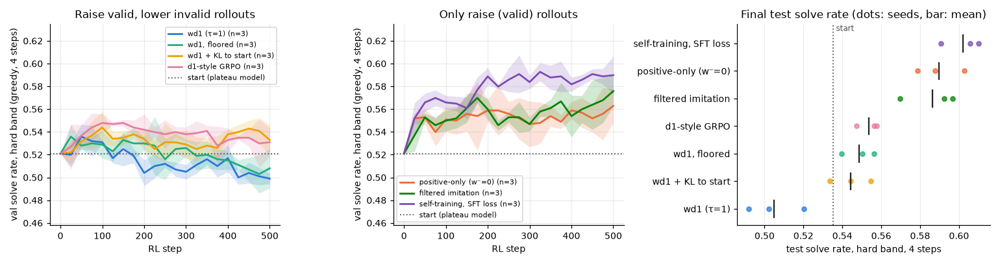
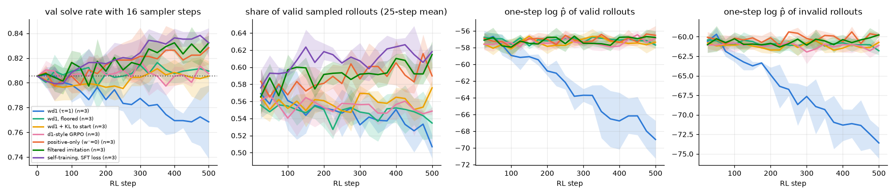

# 4.4 The phase 3 objectives on 9×9, at their phase 3 settings

**Goal:** run the seven objectives of phase 3 from the 9×9 plateau model and check four phase 3 claims on a harder task.

**Setup (fixed before any run)**
- Start: `~/dllm-cache/phase4/sft/sft/final.pt` (sha256 pinned in `configs/phase4_rl.yaml`), the 4.1 model. No half-trained snapshot.
- Task: hard band only (k 51–56; 33,334 train, 334 val, 667 test puzzles), rollouts and evaluation with **4 sampler steps** (chosen in 4.3 by the rule in the spec). The solve rate at 16 steps is logged next to it (`val_solve_ref`).
- Everything else as in phase 3: 32 puzzles × 8 rollouts per step, temperature 1, `confidence` order, 4 inner steps, lr 1e-5, binary reward, one-step likelihood estimate, 500 steps, seeds 0, 1, 2.
- Arms: wd1 (τ 1); positive-only (β 0); wd1 with floor −75.6 (10th percentile of the one-step log p̂ of invalid rollouts at the start, `results/phase4/4.3/floor.json`); wd1 + KL to the start (0.01); filtered imitation; self-training with the SFT loss; d1-style GRPO.
- Trainer: `src/phase3/rl.py`, which now reads `task: sudoku9` from the config. Regression guard rerun after this change: phase 2 strategies table identical, phase 3 RL log equal up to 3.8e-6 (MPS noise, as before).

**Measured at the start** (4.3, 512 train puzzles × 8 rollouts): 56% of sampled rollouts valid; 24% of groups with unequal rewards; median one-step log p̂ −52 for valid and −62 for invalid rollouts. Greedy solve at 4 steps: val 0.521, test 0.535; at 16 steps: val 0.805.

## Predictions, written before the runs
Each is the phase 3 claim carried over, with what would count as "held".
1. **wd1 improves steadily but slowly, and its log p̂ of valid rollouts falls.** Held if val solve (4 steps) at step 500 is above the start in all three seeds, by less than the best arm, and `logp_valid` is lower at the end than at the start.
2. **Bounding the push down makes wd1 faster.** Held if both the floored and the KL variant end above plain wd1, with a paired interval over test puzzles (seeds pooled) that excludes zero.
3. **Positive-only at τ = 1 puts about half of its positive weight on invalid rollouts and collapses early.** Held if `w_pos_on_invalid` is between 0.3 and 0.6 over the first 50 steps and val solve falls by more than 0.10 below the start within the first 150 steps in at least two seeds. My own expectation, noted here so it can be checked: the weight share will be about 0.4, but the collapse is less likely than on the toy because this start is a plateau model, not a half-trained one.
4. **Training on one's own valid rollouts is the best objective when valid rollouts are common** (they are: 56%). Held if self-training or filtered imitation has the highest mean test solve at step 500.

Extra expectation, not a phase 3 claim: because 3 groups in 4 carry no signal for the group-relative objectives, wd1, its variants and GRPO have about a quarter of the effective batch of the two imitation arms.

**Commands**
```
SEED=0 bash scripts/run_phase4.sh rl44 python     # also SEED=1 and SEED=2; 7 runs each
bash scripts/run_phase4.sh rl44-h python          # horizon check: one wd1 run of 1,000 steps
```
## Results (21 runs, 2026-11-10)

Hardware: Apple M5, 24 GB, macOS 27.0.1, torch 2.15.0, MPS, fp32. Seeds 0, 1, 2. Wall-clock: 2 h 29 min for the 21 runs with three seeds side by side (16 to 28 minutes per run; one run alone takes about 7). This launch was estimated at 95 minutes and went over the 2-hour line; later launches are planned at 20 minutes per run. Files: `results/phase4/4.4/` (`curves.csv`, `runs.csv`, `per_seed.csv`, `summary.csv`, `paired.csv`, `test_solved.csv`, `predictions.json`, `objectives.png`, `diagnostics.png`), built by `python -m phase4.rl_analysis compact|evaluate|report 4.4`.

Hard band, greedy `confidence` decoding. Start: val 0.521 and test 0.535 with 4 sampler steps, test 0.814 with 16. Mean over three seeds at step 500; the difference to the start is paired over the 667 hard test puzzles (seeds pooled, bootstrap over puzzles, so the interval does not include seed-to-seed variation; the seed standard deviation of test solve is 0.006 to 0.014).

| objective | val, 4 steps | test, 4 steps | test − start, 4 steps | test, 16 steps | test − start, 16 steps |
|---|---|---|---|---|---|
| self-training, SFT loss | 0.590 | 0.602 | +0.067 [+0.038, +0.095] | 0.837 | +0.022 [0.000, +0.045] |
| positive-only (β 0) | 0.563 | 0.590 | +0.054 [+0.031, +0.078] | 0.835 | +0.020 [−0.002, +0.041] |
| filtered imitation | 0.576 | 0.586 | +0.051 [+0.025, +0.078] | 0.835 | +0.020 [−0.001, +0.042] |
| d1-style GRPO | 0.531 | 0.554 | +0.018 [−0.001, +0.037] | 0.829 | +0.015 [−0.003, +0.032] |
| wd1, floor −75.6 | 0.508 | 0.549 | +0.013 [−0.009, +0.037] | 0.824 | +0.009 [−0.011, +0.029] |
| wd1 + KL 0.01 | 0.533 | 0.544 | +0.009 [−0.011, +0.029] | 0.826 | +0.012 [−0.005, +0.029] |
| wd1 (τ 1) | 0.499 | 0.505 | −0.030 [−0.058, −0.004] | 0.792 | −0.022 [−0.042, −0.002] |




- **Only the three objectives that raise valid rollouts and never lower anything move the model**, by 5 to 7 points at 4 steps. The four group-relative objectives that also lower invalid rollouts end within the interval of the start, or below it (plain wd1).
- **Plain wd1 makes the model worse** in all three seeds, at 4 and at 16 steps. Its one-step log p̂ falls for valid rollouts (−57 to −68) as much as for invalid ones (−60 to −73), and the share of groups it skips rises from 0.76 to 0.89.
- **Self-training uses 69% of the groups, the others 20 to 30%.** It skips only groups with no valid rollout (0.31); the other objectives skip all groups with equal rewards (0.70 to 0.83). Self-training minus filtered imitation: +0.016 [−0.001, +0.033] at 4 steps, so the larger effective batch is not shown to matter.
- **Nothing was broken outside the trained band:** easy stays at 1.000 and medium between 0.993 and 0.997 (start 0.996) at 16 steps for every objective.
- The gains are small next to the gap the sampler steps leave open (0.535 at 4 steps, 0.814 at 16): the best arm closes about a quarter of it.

### Predictions scored (`predictions.json`)
1. **wd1 slow but steady, log p̂ of valid rollouts falls: not held.** The likelihood does fall, but wd1 does not improve: 0 of 3 seeds end above the start on val, and the test difference is −0.030 [−0.058, −0.004]. On the toy it improved slowly; here it degrades.
2. **Bounding the push down makes wd1 faster: held by its written criterion, with a caveat.** Floored − wd1 = +0.044 [+0.022, +0.066], KL − wd1 = +0.039 [+0.018, +0.061]. The caveat: both bounded arms only undo the damage; neither is distinguishable from the start.
3. **Positive-only puts about half its positive weight on invalid rollouts and collapses: not held.** The weight share is 0.36 (inside the stated 0.3 to 0.6), but there is no collapse: val solve never goes below the start in any seed, and positive-only is among the three best arms. This is the outcome I had noted as more likely for a plateau start.
4. **Training on one's own valid rollouts is best when valid rollouts are common: held.** Self-training has the highest mean test solve (0.602); filtered imitation and positive-only are within its interval.

Extra expectation (group-relative objectives have about a quarter of the effective batch): the skipped share is as expected (0.70 to 0.83), but filtered imitation and positive-only skip as many groups as wd1 and still gain 5 points, so the missing signal is not what holds the group-relative arms back.

**What this shows:** on the 9×9 plateau model at 4 sampler steps, only pulling up valid rollouts helps (+5 to +7 points on hard test puzzles), pushing down invalid ones gives nothing even when bounded, and unbounded it hurts. Two of the four phase 3 claims carry over (2 and 4); the wd1 claim and the positive-only collapse do not.
**What this does not show:** whether the push-down objectives fail because of the one-step likelihood estimate, the 4-step start or the settings carried over from 4×4 untuned (τ, lr, floor rule); whether more than 500 steps changes the order of the arms (horizon check below); anything about models that are not at a plateau.

