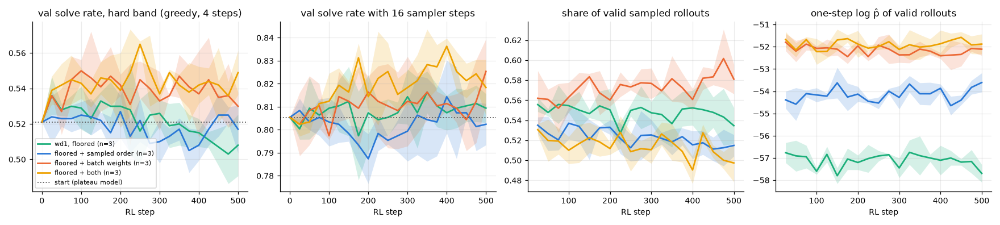

# 4.5a Factorial on floored wd1: sampled unmasking order × weights over the batch

**Status:** done. Setup and predictions were committed before the runs (`352b5d8`); results are at the end.

**Goal:** 4.4 found that the group-relative objectives get no signal from about 3 groups in 4 (all rollouts valid or all invalid) and at best undo the damage of plain wd1. Two ways to get signal from more groups, from `docs/RL_DLLM_SURVEY.md` (proposals 2a and 3, both existing ideas applied here), tested together:

- **Sampled order.** In rollouts the cells to commit at each sampler step are drawn without replacement with weights `confidence^(1/τ_o)`, τ_o = 0.05, instead of the top k. 4.4b measured that this turns 0.26 → 0.54 of groups into groups with unequal rewards at the same valid share. The loss is unchanged (one-step likelihood; the order is not in the gradient). Evaluation stays greedy with the fixed order.
- **Weights over the batch.** The wd1 softmax is taken over all 256 rollouts of the batch instead of within each group of 8 (`phase3.objectives.wd1_batch`). An all-valid group is then pulled up and an all-invalid group pushed down (down to the floor), so no group is skipped.

A note on the second factor. The survey called it "batch-mean baseline". With wd1's softmax weights a change of baseline alone does nothing (a softmax ignores a constant shift), so what is changed is the set the softmax runs over. This was fixed before the runs.

| arm | order | weights | runs |
|---|---|---|---|
| floored wd1 (4.4) | fixed | group | reused from 4.4 |
| + sampled order | τ_o = 0.05 | group | 3 seeds |
| + batch weights | fixed | batch | 3 seeds |
| + both | τ_o = 0.05 | batch | 3 seeds |

All arms: wd1, β = 1, τ = 1, floor −75.6, start and every other setting as in 4.4 (`configs/phase4_rl.yaml`: hard band, 4 sampler steps, 32 puzzles × 8 rollouts, 4 inner steps, lr 1e-5, 500 steps). With `order_temp: 0` and `weights_over: group` the code path and random stream are those of 4.4.

**Command**
```
for arm in ord batch both; do for s in 0 1 2; do SEED=$s bash scripts/run_phase4.sh rl45a-$arm ~/dllm-cache/venv/bin/python & done; wait; done
PYTHONPATH=src python -m phase4.rl_analysis compact 4.5a && python -m phase4.rl_analysis evaluate 4.5a && python -m phase4.rl_analysis factorial 4.5a
```
Hardware: Apple M5, 24 GB, macOS 27.0.1, torch 2.15.0, MPS, fp32. Logs and checkpoints in `~/dllm-cache/phase4/4.5a/`.

**Expected time.** A 20-step trial of the "both" arm took 2.6 s per step with one other job running, because every group now goes through the gradient pass (4.4: about 1 in 4). With three seeds in parallel: about 20 minutes for the sampled-order arm and 40 to 50 minutes for each batch arm, so about 1 h 50 min in total, more than the 1 h announced. The three arms are launched one after the other, each under an hour.

## Predictions (written before the runs)

The 20-step trial was seen before writing these (equal-reward groups about 0.5 with sampled order; nothing about solve rates).

1. **Sampled order uses more groups:** the share of skipped groups in the sampled-order arm is below 0.6 over the run (4.4 floored arm: 0.70 to 0.83). Confidence: high, it follows from 4.4b unless training moves it.
2. **Sampled order helps:** the sampled-order arm ends above the floored arm of 4.4 on hard test at 4 steps, paired interval excluding zero (the survey's prediction). Confidence: low. Against it: the rollouts use a noisier order than the greedy sampler that is evaluated, and in 4.4 the arms with negatives only undid damage.
3. **Batch weights help:** the batch arm ends above the floored arm of 4.4, paired interval excluding zero (the survey's prediction). Sharper: it also ends above filtered imitation of 4.4 (+0.051 over the start); if it only matches it, the push-down of all-invalid groups adds nothing. Confidence: medium for the first part (all-valid groups are pulled up, which is close to self-training, the best arm of 4.4), low for the second.
4. **The two overlap:** the gain of "both" over the floored arm is smaller than the sum of the two single gains.
5. **No collapse:** no arm ends below the start (0.535) by more than its interval, and `logp_valid` does not fall as it did for plain wd1 (−57 → −68).

Deciding measurement: hard test solve at 4 sampler steps at step 500, paired over the 667 test puzzles with seeds pooled, as in 4.4; 16 steps reported next to it.

## Results (step 500, 3 seeds per arm)

Wall-clock on 2026-11-10, three seeds side by side: sampled order 30 min (20:57 to 21:27), batch weights 49 min (21:27 to 22:16), both 48 min (22:16 to 23:04); 2 h 7 min in three launches. Seeds 0, 1, 2; MPS is not fully deterministic. Files in `results/phase4/4.5a/`: `curves.csv`, `runs.csv`, `per_seed.csv`, `summary.csv`, `paired.csv`, `test_solved.csv`, `factorial.png`. The first row and the two reference rows are the 4.4 runs.

Hard test band, 667 puzzles, greedy decoding. Start: 0.535 at 4 steps, 0.814 at 16. Differences are paired over puzzles with seeds pooled, 95% bootstrap interval over puzzles (not over seeds).

| arm | test, 4 steps (std over seeds) | minus start, 4 steps | test, 16 steps | minus start, 16 steps | groups with equal rewards | groups skipped |
|---|---|---|---|---|---|---|
| floored wd1 (4.4) | 0.549 (0.008) | +0.013 [−0.009, +0.037] | 0.824 | +0.009 [−0.011, +0.029] | 0.72 | 0.72 |
| + sampled order | 0.547 (0.005) | +0.012 [−0.013, +0.038] | 0.818 | +0.003 [−0.020, +0.026] | 0.45 | 0.45 |
| + batch weights | 0.579 (0.007) | +0.044 [+0.019, +0.069] | 0.823 | +0.008 [−0.013, +0.029] | 0.79 | 0 |
| + both | 0.572 (0.009) | +0.037 [+0.013, +0.063] | 0.835 | +0.020 [−0.001, +0.041] | 0.41 | 0 |
| filtered imitation (4.4) | 0.586 (0.014) | +0.051 [+0.025, +0.078] | 0.835 | +0.020 | 0.78 | 0.78 |
| self-training (4.4) | 0.602 (0.010) | +0.067 [+0.038, +0.095] | 0.837 | +0.022 | - | 0.31 |

| paired difference, 4 steps | value |
|---|---|
| sampled order − floored | −0.001 [−0.018, +0.015] |
| batch weights − floored | +0.030 [+0.012, +0.050] |
| both − floored | +0.023 [+0.003, +0.044] |
| both − batch weights | −0.007 [−0.020, +0.006] |
| batch weights − filtered imitation | −0.007 [−0.027, +0.013] |
| batch weights − self-training | −0.023 [−0.046, 0.000] |
| both − self-training | −0.030 [−0.052, −0.008] |
| interaction (both − order − batch + neither) | −0.005 [−0.025, +0.014] |



**Predictions**

1. Sampled order uses more groups: **held** (0.45 skipped over the run against 0.72).
2. Sampled order helps: **not held** (−0.001 [−0.018, +0.015]). Nearly twice as many groups gave a gradient and the test solve rate did not move. By the survey's own reading, the number of groups with unequal rewards was not what held the group-relative objective back.
3. Batch weights help: **held** against the floored arm (+0.030 [+0.012, +0.050]). The sharper version, above filtered imitation, **not held** (−0.007 [−0.027, +0.013]): it matches filtered imitation and is at or below self-training.
4. The two overlap: **not decided.** The interaction is −0.005 [−0.025, +0.014]; since sampled order alone does nothing, "both" is simply about equal to batch weights alone at 4 steps.
5. No collapse: **held.** No arm ends below the start, and `logp_valid` stays flat in all three new arms (it is a mean over the groups in the gradient pass, which differ between arms, so levels are not comparable across arms; only the trend is).

**Reading.** The gain of batch weights comes with the groups where all 8 rollouts are valid being pulled up, which is what filtered imitation and self-training already do; it reaches their level and not beyond. So in this setup every arm that improves the 4-step solve rate does so by raising the likelihood of valid rollouts, and nothing here shows a benefit from the push-down term, whether it gets signal from 28%, 55% or 100% of the groups. This agrees with 4.4 and with phase 3.

**Shows:** on the 9×9 plateau model at 4 steps, more unequal-reward groups through a sampled order (τ_o = 0.05) do not improve floored wd1; taking the weights over the batch does, by about +0.03, up to the level of filtered imitation.
**Does not show:** that order sampling is useless in general. Only one τ_o, the order was not in the gradient (proposal 2b), and rollouts used a noisier order than the greedy sampler that is evaluated. It does not separate the pull-up of all-valid groups from the push-down of all-invalid ones inside the batch arm (a batch arm with β = 0 would). At 16 steps "both" is +0.020 over the start with an interval touching zero, and the 16-step interaction is +0.018 [−0.002, +0.037]: suggestive, not established. Three seeds; intervals are over puzzles.
