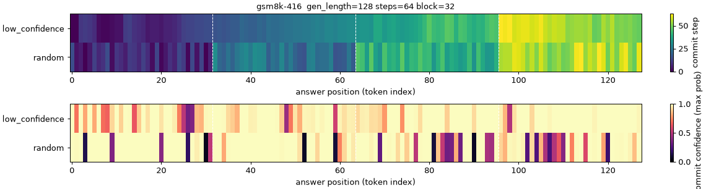
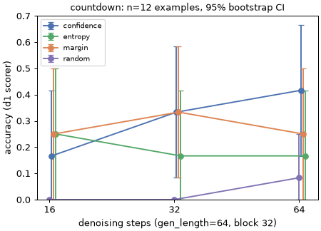
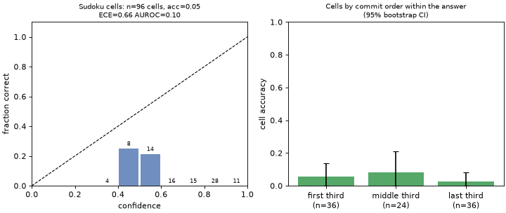
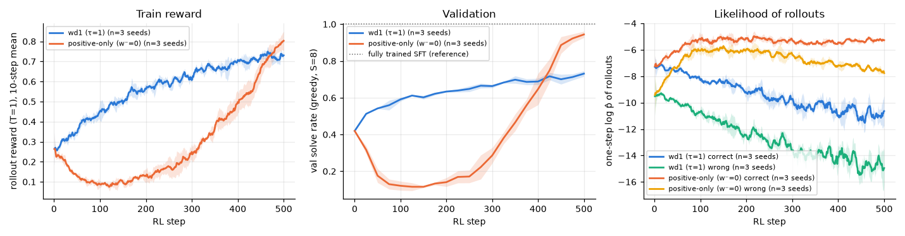
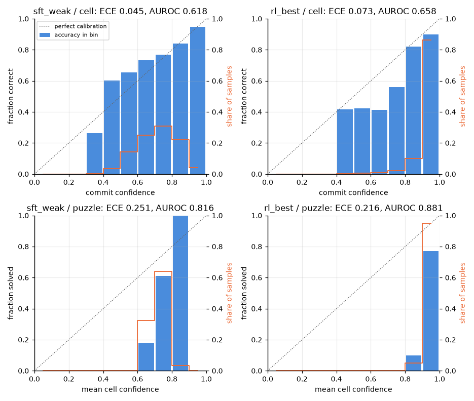
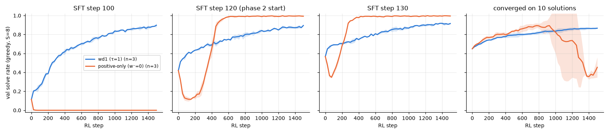
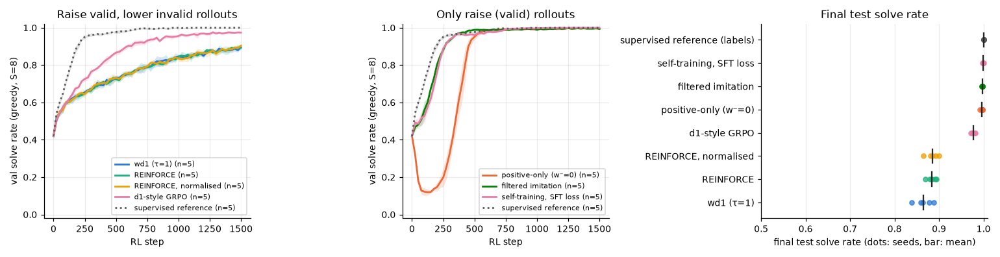

# Diffusion language models on a MacBook: what I learned

Everything below ran on one Apple M5 MacBook with 24 GB of unified memory, using PyTorch on MPS. No cloud GPUs were used. This is a learning exercise, not research: nothing here is a new method, and negative or contrary results are kept as they came out. Details, commands and per-step notes are in `results/phase1/SUMMARY.md`, `results/phase2/SUMMARY.md`, `results/phase3/SUMMARY.md`, `experiments/<id>/README.md`, and the three executed notebooks in `notebooks/`.

## 1. A real dLLM: LLaDA-8B-Instruct (inference only)

**It runs, slowly.** In bf16 the weights take about 16 GB on MPS. One denoising step takes about 0.4 s when the machine is idle and about 0.9 s under contention, so a 64-token answer at 64 steps takes about a minute. This speed is what limited the sample sizes: n = 12 Sudoku, 12 Countdown and 5 GSM8K (the spec asked for 100/100/50), about 5 h of compute in total. Every phase 1 number is therefore a pilot estimate with intervals of ±0.2–0.4.

**Confidence-ordered unmasking is almost autoregressive.** With LLaDA's `low_confidence` remasking, each 32-token block fills in mostly left to right: the Spearman correlation between position and commit step is 0.64 within a block. Random order gives −0.18, and its intermediate text is incoherent.

**Strategy matters on Countdown; step budget barely mattered.** Confidence ordering beat random by +0.28 [0.11, 0.44] (paired, 95% bootstrap), the only difference whose interval excludes zero. Confidence, margin and entropy cannot be separated at this n. Halving the steps halved the wall time with no detectable accuracy loss.

**Commit confidence is not a good error signal here.** Answers are strongly overconfident: 0.87 confidence against 0.42 accuracy on Countdown (ECE 0.45). On Sudoku, cell-level confidence is *anti*-predictive (AUROC 0.10): the model mostly copies the puzzle's `0` placeholders at confidence about 0.75, and those cells are always wrong. Confidence tracks how easy a token is to produce, not whether it is right. Sudoku got 0 full solves in 144 generations, so the Sudoku strategy comparison is uninformative.

## 2. A toy dLLM trained from scratch, then RL with a hand-written wd1

**Setup.** All 288 valid 4×4 Sudoku grids were split by solution (200/44/44) into unique-solution puzzles. The model is an 0.8M-parameter bidirectional transformer trained with the LLaDA/MDLM masked-diffusion loss (1/t weighting); SFT took 13 minutes on MPS. A model with plain position embeddings plateaued at 14% val, and adding row/column/box embeddings fixed it (the failed attempt is kept). To leave RL room to improve, I deliberately took an under-trained checkpoint at 0.48 test solve rate. The fully trained model solves 100%.

**Decoding order matters for a weak denoiser.** At 8 steps, confidence order solves 0.48 and random order 0.14. The fully trained model solves 99.8% in a single step, so order stops mattering once the model is competent.

**wd1 vs positive-only: the early collapse reproduces; the final ranking does not.** Three seeds each, 500 RL steps, about 1 minute per run:

| | test solve rate |
|---|---|
| weak SFT start | 0.482 |
| wd1, τ = 1 | 0.738 ± 0.005 |
| wd1, τ = 0.5 / 2 | 0.740 / 0.743 |
| positive-only (w⁻ = 0) | 0.932 ± 0.016 |

Positive-only collapses early in every seed (val 0.42 → ≈0.10 within 75–150 steps, while the likelihood of its own wrong samples rises), as the wd1 paper warns. It then recovers and passes wd1 around step 400. wd1 never dips but plateaus lower. Likely reasons, none tested: binary rewards on a near-trivial task, a starting checkpoint one sharpening step away from solving, and no KL/reference term. This should not be read as evidence against wd1 at scale. τ barely matters.

**The likelihood proxy is usable.** wd1's one-step mean-field log-likelihood correlates with a sequential one-cell-at-a-time log-likelihood (Spearman 0.86), but it is biased low by about 3 nats.

**RL changes calibration in two directions at once.** After wd1, confidence ranks right vs wrong better (puzzle AUROC 0.82 → 0.86), but cells move from slightly under-confident to over-confident (cell ECE 0.045 → 0.063).

## 3. Playing with RL on the toy: what the phase 2 result was made of

Phase 3 used the toy (about 240 training runs of 1–4 minutes) to find out why positive-only beat wd1, and to try a few things around wd1. Every experiment had a prediction committed before its runs; about a third of them were wrong, and they are listed in `results/phase3/SUMMARY.md`.

**The phase 2 ranking survives longer training but not a different starting model.** At 2,000 steps positive-only still leads wd1, 0.997 to 0.907 (5 seeds). But the start used in phase 2 was a snapshot of a model about to become good. Ten SFT steps earlier, positive-only destroys the model (0.000 in all seeds) while wd1 reaches 0.88. From a model trained to convergence on only 10 of the 200 solutions, positive-only rises above wd1 and then collapses below its start; wd1 improves steadily.

**Positive-only collapses when its weights are flat.** With 0/1 rewards and τ = 1 about half of the positive weight falls on *invalid* rollouts, so the model reinforces its own mistakes. With selective weights (τ ≤ 0.1) the early collapse disappears. With a graded reward the weights are flat again at any τ tried and the collapse is permanent.

**wd1 behaves like plain REINFORCE here, and what holds it back is the unbounded push down.** Its estimated likelihood of its own valid rollouts falls from −7 to −12 while it trains. Anything that bounds that push fixes it: a floor on the negative term (0.86 → 0.99), a small KL penalty to the starting model (0.86 → 0.98, the ingredient that made d1-style GRPO better than wd1), or any β < 1 on the negative term. β = 2 destroys the model. The upstream wd1 code has no reference term in its loss; mixing a reference policy into the sampling, the way it does, changed little here.

**The simplest label-free objective was the most robust:** training with the ordinary SFT loss on the model's own valid rollouts reached about 100% from all three starting models. That depends on two features of the toy: a valid grid is always a correct one, and valid rollouts exist from the start.

**Unmasking order has a large headroom that a small learned policy barely touches.** With the frozen weak denoiser and one cell per step, an oracle that knows the solution solves 0.98 of the test puzzles, the confidence rule 0.56. RL on the validity reward rediscovers the confidence rule from a random order in about 50 steps; given the denoiser's hidden state it reaches 0.67. A head trained *with* the solutions does no better, and the learned policy does not transfer to other denoisers.

**A stated-confidence token learns to check its own answer, but only with a stationary target.** Trained together with the grid, it locked onto one value and stopped exploring; a two-parameter recalibration of the model's existing confidence was far better (Brier 0.067 against 0.128 raw). On a frozen model, the same token trained from the Brier-shaped reward alone reached a Brier score of 0.03–0.05 by learning to verify the completed grid. Read from the puzzle alone, it states the base rate.

**Three robustness checks, run after the summary, moved two of these claims.** (i) With a chain-rule likelihood in the loss instead of the one-step proxy, the ranking of wd1, floored wd1 and positive-only is unchanged, but every arm trains worse and plain wd1 ends below its start (val 0.33 at step 1000 against 0.84; 0.53 when the likelihood follows the sampler's own path). The unbounded push down is therefore not an artefact of the proxy; why the crude proxy trains best is not known. (ii) From an earlier start where about 1 rollout in 700 is valid, both "train on your own valid rollouts" objectives learn nothing (0.00) and the floored wd1 reaches 0.99: the most robust objective above is robust only where successes are not too rare. (iii) A reward that ignores the 2×2 boxes changed no true solve rate by more than 0.03. Details and the failed predictions: `experiments/3.6a`–`3.6c`.

## What surprised me
- How close LLaDA's default decoding is to left-to-right generation.
- That fewer denoising steps cost almost nothing at these sizes. Confidence-based adaptive step budgets look like the obvious next thing to try.
- That LLaDA's token confidence can be actively misleading (the Sudoku zeros).
- That the positive-only ablation won in the end on the toy task, despite collapsing early.
- That the explanation was so mechanical: flat weights, an unbounded push down, and one lucky starting snapshot. Changing any one of them changes the ranking.
- That plain self-training on one's own valid outputs beat every RL objective on the toy.
- That an oracle unmasking order solves 98% of the puzzles the weak model "cannot" solve.

## Limitations
- Phase 1 samples are tiny, GSM8K used 128-token answers instead of 256, and the d1/paper settings were not matched. Phase 1 numbers are not comparable to published ones.
- Phase 2 is a toy: 4×4 only, binary rewards, no KL term, one hyper-parameter setting, 3 seeds.
- MPS is not bit-deterministic, and timings were taken on a shared machine (phases 1 and 2 ran concurrently, plus a Docker VM).
- Phase 3 is the same toy with 3 seeds per setting, one hyper-parameter setting, a one-step likelihood proxy and 1,500-step runs. Its findings are about this task; which of them carry over to a pretrained dLLM with sparse, imperfect rewards is not tested here.

## Reproduce
- Phase 1: `scripts/run_phase1.sh`. The grid is resumable; raise `N_SUDOKU`/`N_COUNTDOWN`/`N_GSM8K` to extend the same nested samples. The full spec sizes need roughly 30+ h on this Mac.
- Phase 2: the commands in `experiments/2.*/README.md` and `scripts/run_phase2_rl.sh`.
- Phase 3: `bash scripts/run_phase3.sh <experiment id>` for each id in `experiments/3.*/README.md`, then `python -m phase3.analysis <id>`.
