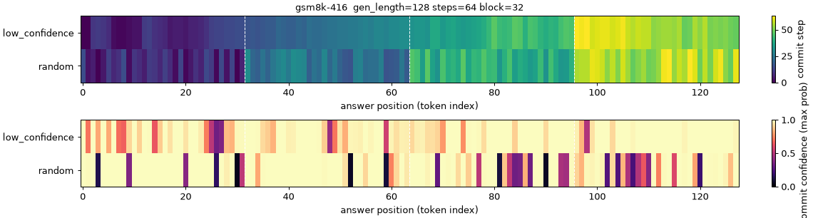
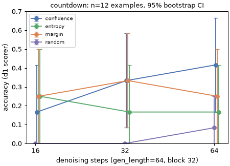
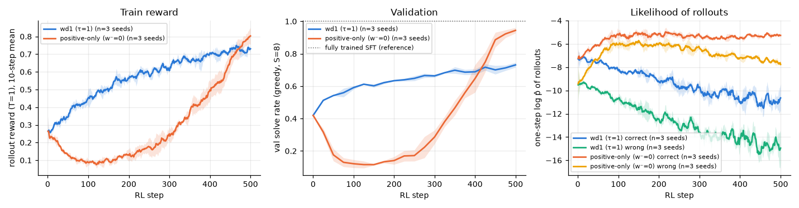
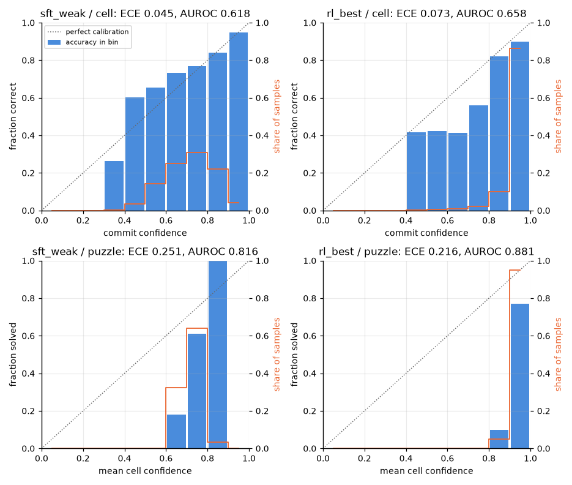
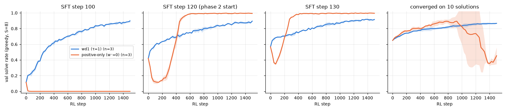
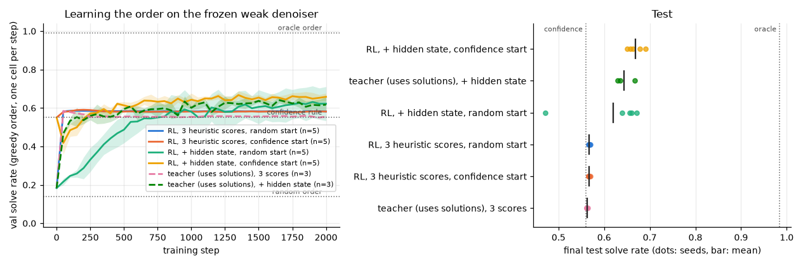
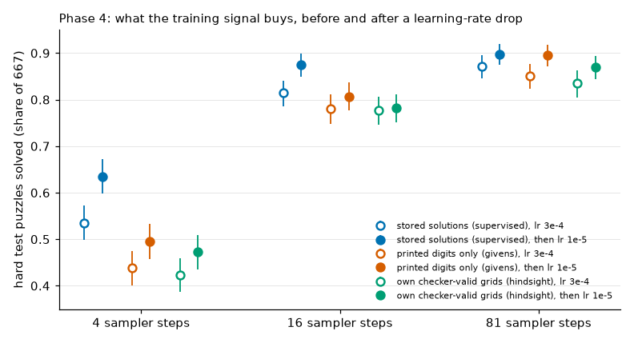

# Diffusion language models on a MacBook, in plain words

This is the simplified companion to [REPORT.md](REPORT.md). It covers the same four phases with less jargon and more "why". Numbers are the same ones as in the full report; nothing new was run for this page. It is a learning exercise, not research, and makes no novelty claims.

Where a sentence starts with *Likely why*, it is an interpretation that was **not** tested.

## The idea in one minute

A normal language model writes one word at a time, left to right. A **masked diffusion language model (dLLM)** works differently:

```
start:   [MASK] [MASK] [MASK] [MASK] [MASK]
step 1:  [MASK]   is   [MASK] [MASK]   .
step 2:   The     is   [MASK]  42      .
step 3:   The     is   answer  42      .     (order is free, several words per step)
```

- **Training:** take a real text, hide a random share of its words, and ask the model to guess the hidden ones. The model can look both left and right.
- **Generating:** start from all masks. At each step the model guesses every hidden word, *commits* a few of them, and keeps the rest masked for later. In the samplers used here a committed word is never revised.
- **Unmasking strategy:** the rule for choosing which words to commit. We compared four: `random`, `confidence` (commit what the model is most sure about), `margin` (biggest gap between first and second choice) and `entropy` (least spread-out guess).

Two questions run through the whole project: **does the order of unmasking matter?** and **can we trust the model's confidence?**

## Phase 1: a real dLLM (LLaDA, 8 billion parameters), inference only

We loaded LLaDA-8B-Instruct on the laptop and tested it on three tasks: 4×4 Sudoku, Countdown (reach a target number with three numbers) and GSM8K (school maths word problems).

| Question | What we saw | Why |
|---|---|---|
| Does it run on a laptop? | Yes: 16 GB of memory, about 0.9 s per step. A short answer takes about a minute. | An 8B model is at the limit of a 24 GB machine. |
| In what order does it write? | With the `confidence` rule it writes *almost* left to right (correlation between position and commit time: 0.64). | *Likely why:* words next to already-known text are the easiest to guess, so they are the most confident and go first. |
| Does the rule matter? | On Countdown, `confidence` beat `random` by 28 points [11, 44], averaged over step budgets. The three "smart" rules could not be told apart. | *Likely why:* `random` commits unsure words early, and they cannot be fixed later. |
| Do more steps help? | Halving the steps halved the time with no loss we could detect. | With samples this small, "no detectable loss" is not the same as "no loss". |
| Can we trust its confidence? | No. On Countdown it was 87% confident and 42% correct. On Sudoku, the cells it was most confident about were mostly the *wrong* ones. | The model copied the puzzle's `0` placeholders with high confidence. Confidence measures how easy a word is to produce, not whether it is correct. |



*Commit order for one GSM8K answer. With the confidence rule (default in LLaDA) each block fills in mostly left to right.*



## Phase 2: a tiny dLLM built from scratch, then reinforcement learning

To understand the pieces from the inside, we built a toy version: a 0.8-million-parameter model that fills in 4×4 Sudoku grids. Training it takes 13 minutes on the laptop.

**Step 1: ordinary training.** Same recipe as above: hide cells, guess them. The fully trained model solves every test puzzle. To leave room for improvement we deliberately took an early, half-trained snapshot that solves **48%**.

**Step 2: reinforcement learning (RL).** RL needs no answer key, only a checker that says "valid" or "not valid":

1. For each puzzle, let the model produce 8 attempts.
2. Score each attempt: 1 if the grid is valid, 0 if not.
3. Compare each attempt with the average of its group of 8.
4. Nudge the model: make better-than-average attempts **more** likely and worse-than-average attempts **less** likely.

This is the **wd1** objective, written by hand here. We also ran a variant, **positive-only**, that keeps the "more likely" part and drops the "less likely" part. The wd1 paper reports that this variant collapses.

| Model | Test puzzles solved |
|---|---|
| half-trained start | 48% |
| start + wd1 | 74% |
| start + positive-only | 93% |
| fully trained (reference) | 100% |



What happened, in order:

- **Positive-only collapsed early**, in all three runs: from 42% down to about 10% on validation puzzles within 150 steps. This matches the paper's warning.
- **Then it recovered and won**, passing wd1 around step 400. This does *not* match the paper.
- **wd1 never dipped**, but it climbed slowly and was still at 74% when the runs stopped at step 500.

*Likely why the collapse happens* (a reading of the code and logs, not a tested cause): with 0/1 scores, the weights that decide "how much to reinforce each attempt" are almost flat. In a group with 2 valid attempts out of 8, the 6 invalid ones still receive about half of the total weight. So positive-only also reinforces the model's own mistakes, and the logs show it becoming more confident in wrong grids. wd1's "less likely" part cancels this.

*Why positive-only wins in the end:* not tested. Candidate reasons are the very easy task, the half-trained starting point, the short runs, and the missing "stay close to the starting model" term.

Two smaller findings:

- **Order matters for a weak model, not for a strong one.** The half-trained model solves 48% with the `confidence` rule and 14% with `random`. The fully trained model solves 99.8% in a single step either way.
- **RL changed confidence in two ways.** After wd1 the model was better at *ranking* right above wrong, but it became over-confident overall (95% confident, 88% correct on cells).



## Phase 3: taking the RL result apart

Phase 3 used the toy to ask *why* positive-only beat wd1, with about 240 short training runs. Each experiment had a prediction written down before it ran; about a third were wrong.

| Question | What we saw | Why |
|---|---|---|
| Was 500 steps too early? | No. At 2,000 steps positive-only still leads, 0.997 to 0.907. | wd1 runs out of signal: late in training 9 groups out of 10 have all-equal scores and teach nothing. |
| Why does positive-only collapse early? | Because its weights are almost flat: about half of the "reinforce this" weight lands on *invalid* attempts. Make the weights selective and the collapse is gone. | The model was being taught to repeat its own mistakes. |
| Does the starting model matter? | Completely. From a snapshot 10 training steps earlier, positive-only destroys the model (0%). From a model trained to convergence on little data, it rises and then collapses. wd1 improves from every start. | The phase 2 start was a model about to become good on its own; "sharpen what you have" works only there. |
| Why is wd1 slow? | Its push-down has no limit: the likelihood of its own *correct* attempts keeps falling. Capping that push (a floor, or a small penalty for drifting from the start) lifts it from 0.86 to 0.98–0.99. | Push up and push down exactly balance in wd1. Tilt it either way and the behaviour changes completely; tilt it towards push-down (β = 2) and the model dies. |
| What is the best label-free recipe here? | The plainest one: ordinary training on your own valid attempts. About 100% from every start. | *Only* because in this toy a valid grid is always the right answer and valid attempts exist from the start. |
| Can the model learn in which order to fill cells? | Some. An oracle order solves 98% with the same weak model (confidence rule: 56%). RL rediscovers the confidence rule by itself and, with more information, reaches 67%. | Knowing which cell you are right about is almost as hard as solving the puzzle. |
| Can it learn to say how confident it is? | Yes, if its abilities are not changing while it learns: it then checks its own grid well (Brier 0.03 against 0.07 for the best after-the-fact fix). Trained while still improving, it fails. | A moving target plus flat weights: it locked onto one value and stopped exploring. |

Three extra checks were run afterwards (3.6a–c), and two rows above need a caveat:

- **"Ordinary training on your own valid attempts is best" holds only if valid attempts are not too rare.** From an even earlier snapshot, where about 1 attempt in 700 is valid, that recipe learned nothing (0%), while wd1 with a capped push-down reached 99%.
- **wd1's push-down problem is real, not a measuring artefact.** With a more exact way of computing "how likely was this attempt", plain wd1 got *worse* (it ended below where it started); the capped version still worked. Every method trained best with the rough estimate, and we do not know why.
- A sloppier checker (one that forgets the 2×2 boxes) made no measurable difference.





## Phase 4: real-size Sudoku, and learning without an answer key

The 4×4 toy was too easy, so phase 4 moved to ordinary 9×9 Sudoku: 100,000 generated puzzles, a model of 1.9 million parameters, five hours of training on the laptop. Scores below are on the 667 **hard** test puzzles, when the model is given 4, 16 or 81 fill-in steps (81 means one cell at a time).

| Question | What we saw | Why |
|---|---|---|
| Does the number of steps matter now? | A lot: 54% solved with 4 steps, 81% with 16, 87% with 81. On the 4×4 toy one step was enough. | A wrong early cell cannot be taken back, and with few steps many cells are fixed at once. |
| Does the order matter? | Enormously: filling cells in random order solves 13%, filling the surest cells first 81%. A perfect order would solve 100% with the same model. | *Likely why:* the sure cells make the others easier. |
| How does it fail? | One or two wrong cells early, then many more that are consistent with those. | The model keeps building on its own mistake. |
| Could it erase and retry? | If told exactly which cells are wrong, yes (91% with 4 passes). On its own, no: it cannot find them (a simple detector finds 6 in 10, about 9 in 10 are needed). | Knowing where you are wrong is the hard part. |
| Does RL help? | It looked like it: practising on its own correct grids gave +7 points. Then we ran the missing control: just keep training normally with **smaller steps** (a lower learning rate). That gave +10 points, and after it the RL step added nothing. | The model had been trained with large steps the whole time. Any gentle extra training polished it, RL or not. |
| Does wd1's push-down help here? | No, in any setting tried. In the last check, on the best model, it cost 8 puzzles in 100 at 4 steps; the same method with the punishing part switched off cost about 1. | Same as on the toy: punishing wrong attempts also damages what the model does right. |
| Can it learn with **no solutions at all**? | Yes. Hide some of the printed digits, ask the model to put them back. That alone gets 50% / 81% / 90% (after the same smaller-steps polish), against 63% / 87% / 90% with the answer key. | The printed digits obey the same rules as the missing ones, so they are free examples. This depends on how our puzzles were generated. |
| Does a checker ("this grid is right / wrong") help it teach itself? | It gives a faster start, not a better finish. A loop that collected its own correct grids for 99% of the hard training puzzles ended no higher than the model that only looked at printed digits. In the last check, a short round of practice on its own correct grids still added about 3 puzzles in 100 to the best no-solutions model at 4 steps, and nothing at 16. | *Likely why:* by the time the model can find a solution on its own, it has little left to learn from it. |



**Five conclusions were corrected by later runs**, and they are all still in the experiment notes. The big one: for a while the notes said "self-training improves the model" and "the no-solutions model matches the supervised one at 4 steps". Both came from comparing a polished model with an unpolished one.

## What did not go well

- **Phase 1 samples are tiny.** 12 Sudoku, 12 Countdown and 5 GSM8K examples instead of the planned 100/100/50, because each answer takes about a minute. The error bars are ±20 to ±40 points. These are pilot numbers and cannot be compared with published ones.
- **Sudoku with LLaDA told us nothing about strategies.** 0 puzzles solved in 144 attempts.
- **GSM8K answers were cut** to 128 tokens instead of 256.
- **The first model load failed** (the laptop started swapping). Loading straight onto the GPU fixed it.
- **The first toy model was stuck at 14%.** It only knew each cell's index. Telling it each cell's row, column and box fixed it.
- **The toy task is too easy.** The interesting regime exists only because we started from a half-trained snapshot, which is an artificial and fragile setup.
- **The RL is simplified.** 0/1 rewards, no "stay close" term, 500 steps, 3 runs per setting, one set of hyper-parameters.
- **Measurements are noisy.** The laptop GPU is not perfectly repeatable, and both phases ran at the same time, so timings are pessimistic.
- **Phase 3 predictions were often wrong**, in the right direction for honesty but a reminder of how little intuition transfers: β = 2 did not just "do worse", it destroyed the model; a graded reward did not help, it killed positive-only; a head trained with the answers was no better than RL.
- **Two phase 3 launches took over two hours** each, above the limit set for a single unattended run, because CPU and GPU jobs slowed each other. Some order-policy runs were moved to the CPU, so that experiment mixes devices (recorded per run).

- **Phase 4 ran the most important control last.** About twenty experiments compared RL objectives and self-training loops on a model trained with a constant learning rate, before anyone checked what a plain learning-rate drop does. A decay schedule in the first training run would have saved most of them.
- **About half of the phase 4 predictions were wrong**, including all three made from the short no-solutions runs about the long ones.
- **Several phase 4 launches ran over their announced time** (up to 2 h 37 min against "under an hour"); the user was told while they ran.
- **The hard test puzzles were looked at many times**, so small differences between experiments (2 to 3 points) should not be trusted.

## Open questions after phase 3 and phase 4

Phase 4 answered the first two of the three questions below only for a small model trained from scratch (push-down still does not pay; the start still decides everything, this time through its learning rate). What it adds:

- Would a learned detector of wrong cells make "erase and retry" work? Nothing else measured here has as much headroom (54% → 91% at 4 passes).
- Does training on printed digits alone work on puzzles whose givens are chosen by hand rather than at random?
- With a proper learning-rate schedule from the start, is there anything left for RL to add on this task?

The questions phase 3 left:

The five questions phase 2 left were all answered on the toy (no; no; less than all; yes, completely; yes, on a frozen model). What is left is whether any of it survives a change of scale:

1. Is wd1's push-down still the bottleneck on a pretrained dLLM, where the likelihood estimate is noisier and rewards are sparser?
2. Does the starting-model dependence show up when the start is a pretrained model rather than a half-trained toy?
3. Is there a cheap order policy that transfers between denoisers?

## Mini glossary

- **dLLM:** a language model that fills in masked text over several steps instead of writing left to right.
- **Commit / unmask:** fix the value of a masked position.
- **Step budget:** how many fill-in steps an answer gets. More steps cost more time.
- **Confidence:** the probability the model gives to the word it picked.
- **Calibration:** whether confidence matches reality. "80% confident" should mean "right 8 times out of 10".
- **ECE:** average gap between confidence and actual accuracy. 0 is perfect.
- **AUROC:** whether confidence ranks right answers above wrong ones. 0.5 is a coin flip; below 0.5 is misleading.
- **RL (reinforcement learning):** learning from a score on the model's own attempts, with no answer key.
- **wd1:** an RL objective for dLLMs that raises the likelihood of better-than-average attempts and lowers that of worse-than-average ones.
- **Learning rate:** how large a correction the model makes at each training step. Large steps learn fast and stay rough; small steps polish.
- **Givens / printed digits:** the digits a puzzle shows at the start.
- **Checker:** a program that says whether a filled grid obeys the Sudoku rules. It does not know the solution.
- **95% interval [a, b]:** the range the true value plausibly lies in, given how few examples we have.
