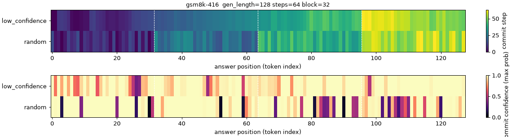
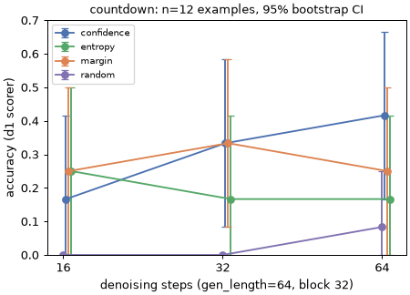
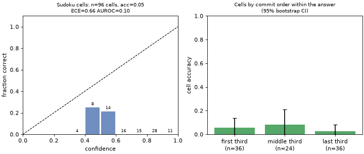

# Phase 1 summary: LLaDA-8B-Instruct on a MacBook

## Setup
- LLaDA-8B-Instruct (revision `08b83a6f`), bf16 on Apple MPS (M5, 24 GB), torch 2.15.0, transformers 4.38.2.
- Sampler: LLaDA's `generate.py` (commit `9182493`) with instrumentation and four unmasking strategies.
- Tasks: d1's zero-shot prompts and scorers (commit `faf85d6`) for Sudoku 4x4, Countdown-3 and GSM8K.
- Decoding: block length 32, temperature 0, no CFG; seed 42 throughout.
- The machine was shared with a Docker VM (~8 GB) and the phase-2 training job, so speeds are under contention.
- Phase 1 compute was about 5.0 h:
  - 1.0 smoke: 3 min;
  - 1.1: 25 min;
  - 1.2 grid: 4 h 34 min;
  - 1.3: seconds;
  - plus a ~75 min model download and one failed first load (swap thrashing; see `env_and_speed.md`).

## Speed (1.0)
16 GB on MPS. **About 0.9 s per denoising step** (0.38 s per forward pass when the machine was idle, 0.8-1.4 s under contention), so a 64-token answer at 64 steps takes about 1 min. Cost is linear in steps, and every strategy costs the same per step.

## Unmasking order (1.1), 9 prompts, gen 128, 64 steps

With `low_confidence`, LLaDA fills each 32-token block mostly left to right: within-block Spearman rho(position, commit step) = **0.64** on average (range 0.37-0.86). With random order, rho is -0.18, as expected for an arbitrary permutation. Under random order the intermediate text is visibly incoherent (GIFs in `unmasking/`).

## Strategies vs steps (1.2); 95% bootstrap CIs over examples
Countdown (n = 12):

| task (n) | confidence @1x | margin @1x | entropy @1x | random @1x |
|---|---|---|---|---|
| Sudoku cell acc. (12) | 0.05 [0.00, 0.11] | 0.06 [0.02, 0.11] | 0.02 [0.00, 0.05] | 0.07 [0.03, 0.14] |
| Countdown (12) | 0.42 [0.17, 0.67] | 0.25 [0.00, 0.50] | 0.17 [0.00, 0.42] | 0.08 [0.00, 0.25] |
| GSM8K, gen 128 (5) | 0.60 [0.20, 1.00] | 0.80 [0.40, 1.00] | 0.80 [0.40, 1.00] | 0.60 [0.20, 1.00] |

- The only paired difference whose interval excludes 0 is **Countdown confidence - random: +0.28 [0.11, 0.44]** (averaged over budgets; `strategies_paired.csv`). Confidence, margin and entropy cannot be told apart at this n.
- Fewer steps (0.25x, 0.5x) did not detectably hurt, and each halving of the steps halves the wall time.
- Sudoku is at the floor for every strategy: 0 full solves out of 144 generations.

## Calibration (1.3), confidence strategy, full budget

- Mean commit confidence is **overconfident**: 0.87 confidence against 0.42 accuracy on Countdown, and 0.95 against 0.60 on GSM8K. ECE is 0.45 [0.20, 0.71] on Countdown, and the AUROC of 0.63 [0.22, 0.96] is not distinguishable from chance.
- **Sudoku cell confidence is anti-predictive (AUROC 0.10 [0.04, 0.17], n = 96 cells).** 71 of 96 empty cells were filled with the puzzle's `0`, copied at confidence 0.75, and all of them are wrong. Confidence measures how easy a token is to copy, not whether the cell is correct.
- Early- vs late-committed tokens: no clear difference (all intervals overlap).

## Limitations
- **Tiny samples.** n = 12/12/5 instead of the spec's 100/100/50, chosen to fit about 6 h of compute at ~1 s per step. Intervals are +/-0.2-0.4, so these are pilot numbers.
- **Shorter GSM8K answers.** GSM8K ran at gen 128 instead of 256.
- **Copy heuristic dominates Sudoku.** Sudoku accuracy is d1's cell metric at 64 tokens. The model mostly copies the puzzle, so the Sudoku strategy comparison is uninformative.
- **Platform differences.** bf16 on MPS (Gumbel noise in fp32, unused at temperature 0), a shared machine, and no exact match with the paper's or d1's evaluation settings: gen lengths, few-shot and n all differ. Numbers are not comparable to published LLaDA/d1 results.
- **One random seed per example.** Variance across seeds was not measured.

## Next questions for phase 2
- Does RL (wd1/d1-style) on a Sudoku-specialised model fix the copy-the-zeros failure, and does commit confidence become predictive after training?
- Is margin or entropy better than max-probability once a model is competent? At this n we cannot tell.
- Can a recalibrated confidence (e.g. min over the answer span, or a learned probe) be used to adapt the step budget per example, given that fewer steps cost little accuracy here?
