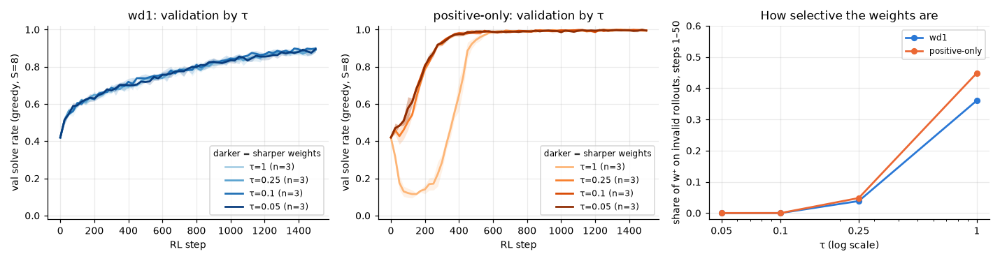
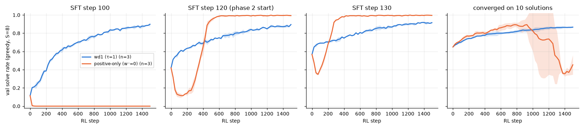
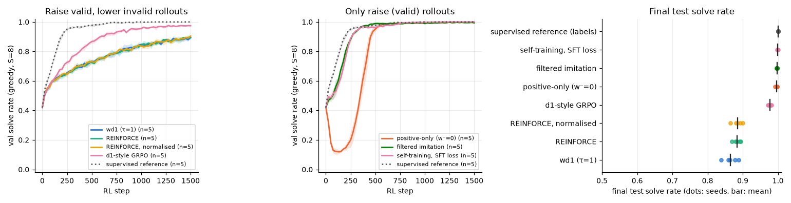
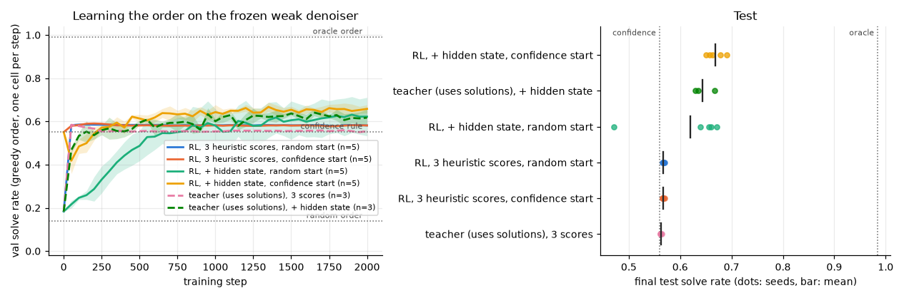

# Phase 3 summary: playing with RL on the toy Sudoku dLLM

This is a set of small experiments on a toy. Nothing here is a new method, and none of it says how these objectives behave on a large dLLM.

- Model and data are those of phase 2: a 0.8M-parameter masked diffusion model on 4×4 Sudoku, 1,194 test puzzles from solutions never seen in training.
- Unless stated, RL starts from the phase 2 weak checkpoint (SFT step 120, test solve rate 0.48), runs 1,500 steps and is scored by the greedy `confidence` sampler with 8 unmasking steps.
- Numbers are mean ± std over seeds (3 for sweeps, 5 for 3.1a and 3.2).
- Every step has its own README in `experiments/3.x/` with the exact command, a prediction committed before the runs, and a check of that prediction.

## The short version

1. **The phase 2 result (positive-only beats wd1) holds for longer runs but belongs to one starting snapshot.** With 2,000 steps positive-only still leads, 0.997 to 0.907. From a snapshot ten SFT steps earlier it destroys the model, and from a model converged on little data it rises and then collapses. wd1 improves from every start.
2. **Positive-only collapses when its weights are flat.** With 0/1 rewards and τ = 1, about half of the "positive" weight is on invalid rollouts, so the model reinforces its own mistakes. With sharp weights (τ ≤ 0.1) the collapse is gone. With a graded reward the weights are flat again and the collapse is permanent.
3. **wd1 behaves like plain REINFORCE here, and what slows it is the unbounded push down.** Its estimated likelihood of its own *valid* rollouts falls from −7 to −12. Bounding the push, with a floor on the negative term or a small KL penalty to the starting model, lifts it from 0.86 to 0.98–0.99.
4. **The best label-free objective on this task is the plainest one:** train with the ordinary SFT loss on the model's own valid rollouts. About 100% from all three starting models.
5. **Unmasking order has a lot of headroom and little of it was learnable.** An oracle order solves 0.98 with the frozen weak denoiser, against 0.56 for the confidence rule. RL rediscovers the confidence rule from scratch, and with the denoiser's hidden state gets to 0.67.
6. **A stated-confidence token trained with a Brier-shaped reward did not beat a two-parameter recalibration** of the confidence the model already has. When the token was trained on a frozen model instead, with a stationary target, it did beat it (Brier 0.03–0.05 against 0.07), by learning to check its own grid.

## Track A: taking wd1 apart

### Horizon (3.1a), 5 seeds, 2,000 steps

| | val, step 500 | val, step 1000 | val, step 2000 | test, step 2000 |
|---|---|---|---|---|
| wd1 (τ = 1) | 0.733 | 0.843 | 0.910 | 0.907 ± 0.017 |
| positive-only | 0.951 | 0.991 | 0.997 | 0.997 ± 0.001 |

wd1 slows down as its signal runs out: late in training 92% of the groups have equal rewards and are skipped.

### Sharp weights (3.1b) and the size of the negative term (3.1c)

| | τ = 1 | τ = 0.25 | τ = 0.1 |
|---|---|---|---|
| positive-only: share of w⁺ on invalid rollouts, steps 1–50 | 0.45 | 0.05 | 0.00 |
| positive-only: lowest val during training | 0.11 | 0.41 | 0.42 (the start) |
| positive-only: final test | 0.996 | 0.997 | 0.997 |
| wd1: final test | 0.860 | 0.874 | 0.886 |

Loss = Σ (β·w⁻ − w⁺)·log p̂ at τ = 1. β = 0 is positive-only and β = 1 is wd1:

| β | 0 | 0.25 | 0.5 | 1 | 2 | 1, with a floor at −12 |
|---|---|---|---|---|---|---|
| lowest val | 0.11 | 0.16 | 0.35 | 0.42 | 0.00 | 0.42 |
| final test | 0.996 | 0.996 | 0.996 | 0.860 | 0.000 | 0.991 |

It is a cliff. When the push up outweighs the push down the model ends near 100%; at the balance point (wd1) it is slow; when the push down dominates it is destroyed. The floored term is not from the wd1 paper. Below the floor a rollout keeps only its positive weight, so the floored objective is wd1 for likely rollouts and positive-only for unlikely ones.

### Starting model (3.1d) and the variants that survive it (3.1g)

Final test solve rate:

| Objective | from SFT step 100 (val 0.11) | from SFT step 120 (val 0.42) | from a model converged on 10 solutions (val 0.65) |
|---|---|---|---|
| self-training with the SFT loss | 0.999 | 0.999 | 1.000 |
| filtered imitation | 0.996 | 0.997 | 0.888 |
| wd1, floor −12 | 0.989 | 0.991 | 0.890 |
| wd1 + KL 0.01 | 0.982 | 0.976 | 0.728 |
| wd1 | 0.879 | 0.860 | 0.791 |
| positive-only (τ = 1) | 0.000 | 0.996 | 0.480 |

- Positive-only from the 10-solution model first rises above wd1 (best val 0.87–0.98), then collapses in all 3 seeds. With early stopping on val it would score 0.91 on test.
- The KL penalty helps when the start is an unfinished model and hurts when it is a converged weak one.
- Plain wd1 is never the best and never fails.

### Graded reward (3.1e) and reference policy in the rollouts (3.1f)

- **Graded reward** (share of valid rows, columns and boxes): wd1 skips fewer groups (12% against 40%) but ends at the same place (0.848 against 0.860). Positive-only goes to 0.000 within 75 steps, at τ = 1 and at τ = 0.25.
- **Reference policy.** The upstream wd1 code (commit `1a2e254`) was read before implementing anything. Its loss is the phase 2 loss with τ = 1 and has no reference term; the reference enters only by mixing logits when sampling rollouts. The toy equivalent changes little: val 0.904–0.911 against 0.895. Test is 4 points higher with no dose-response, which 3 seeds cannot settle.

## Track B: wd1 next to simpler objectives (3.2, 3.2b)

5 seeds, same rollouts, likelihood estimate and budget:

| Method | final test | lowest val | uses labels |
|---|---|---|---|
| supervised reference | 1.000 ± 0.000 | 0.42 | yes |
| self-training with the SFT loss | 0.999 ± 0.001 | 0.42 | no |
| filtered imitation | 0.997 ± 0.001 | 0.42 | no |
| positive-only (τ = 1) | 0.996 ± 0.003 | 0.11 | no |
| d1-style GRPO | 0.977 ± 0.005 | 0.42 | no |
| REINFORCE (also with normalised advantages) | 0.884 ± 0.010 | 0.42 | no |
| wd1 (τ = 1) | 0.865 ± 0.019 | 0.42 | no |

GRPO's clipping was never active, so what separates it from REINFORCE is its KL penalty to the starting model. 3.2b tested that directly (3 seeds):

| | without KL | with KL |
|---|---|---|
| GRPO | 0.871 | 0.978 |
| REINFORCE | 0.880 | 0.978 |
| wd1 | 0.860 | 0.976 (weight 0.01), 0.896 (weight 0.04) |

With the KL term the estimated log-likelihood of the model's own valid rollouts stays near −8 instead of drifting to −12. This supports the phase 2 guess that a missing reference term was holding wd1 back, for this toy.

## Track C: rewarding honest confidence (3.3, 3.3b)

A 17th position reads the grid through the denoiser's layers and states one of four confidence values. Reward: r − (q − r)², highest for an honest q (idea from RLCR).

Test set, wd1-trained models (solve rate about 0.86–0.88; always stating the base rate scores a Brier of about 0.11):

| Confidence | Brier | ECE | AUROC |
|---|---|---|---|
| implicit (mean commit confidence), raw | 0.128 | 0.121 | 0.919 |
| implicit, recalibrated on val with 2 parameters | 0.067 | 0.020 | 0.919 |
| token read from the completed grid, RL, trained with the grid (3.3) | 0.296 | 0.408 | 0.516 |
| token read from the completed grid, probe, trained with the grid (3.3) | 0.279 | 0.479 | 0.934 |
| token read from the completed grid, RL, frozen denoiser (3.3b) | 0.047 | 0.127 | 0.932 |
| token read from the completed grid, probe, frozen denoiser (3.3b) | 0.032 | 0.135 | 0.980 |
| token read from the puzzle alone, frozen denoiser (3.3b, both modes) | 0.121 | 0.017 | 0.58–0.66 |

- The over-confidence seen in phase 2 is real (0.98 stated against 0.86 solved) and a two-parameter map fitted on val removes most of it.
- Trained together with the grid, the token settles on the value that fits the early solve rate and, in RL mode, stops exploring.
- On a frozen model (3.3b) the same token learns to verify the grid it has just written, with RL (REINFORCE on the Brier reward) a little behind the exact-gradient probe. Read from the puzzle alone, it states the base rate: it knows nothing about the puzzle's difficulty that the solve rate does not already say. The high ECE of the good tokens is an artefact of the four allowed values.

## Track D: unmasking order (3.4a, 3.4b)

Frozen weak denoiser, one cell per step, test solve rate:

| Order | solve rate |
|---|---|
| random | 0.144 |
| confidence rule | 0.560 |
| RL policy on the 3 heuristic scores | 0.567 ± 0.002 |
| RL policy with the denoiser's hidden state | 0.668 ± 0.016 |
| the same head trained with the solutions | 0.644 ± 0.021 |
| oracle (knows the solution) | 0.984 |

- From a uniformly random order, RL on the validity reward arrives at the confidence rule in about 50 steps (96% of its choices are the same).
- The hidden-state policy is tied to its denoiser: on every other denoiser, including one 10 SFT steps away, it is below the confidence rule.
- Here the log-probability of an order is exact, so no likelihood proxy is involved, unlike in tracks A–C.

## Predictions that were wrong

Each experiment's prediction was committed before its runs. These are the ones that failed:

- 3.0: the curves would drift from phase 2's because MPS is not deterministic. They matched exactly.
- 3.1b: wd1 would gain at least 3 points from sharp weights. It gained nothing on val.
- 3.1c: the final solve rate would fall gradually with β, and β = 2 would not collapse. It is a cliff, and β = 2 goes to zero.
- 3.1d: wd1 from SFT step 100 would stay below 0.6. It reached 0.88.
- 3.1e: positive-only with a graded reward would still end above 0.95. It went to zero.
- 3.2: GRPO would be within 5 points of wd1. It was 11 above.
- 3.3: the confidence token would reach AUROC 0.90 and beat the recalibrated implicit confidence. It did neither.
- 3.4b: a head trained with the solutions would reach about 0.85. It reached 0.64.
- 3.1g: wd1 + KL from SFT step 100 would end below plain wd1 (it ended 10 points above), and the floored wd1 would be unstable from the 10-solution model (it was stable).

## Run notes

- **Three experiments are not in the original spec:** 3.2b, 3.1g and 3.3b. Each was added after seeing a result, and each has its own prediction committed before its runs. The 3.3b prediction was written after a 40-step smoke test of the code and says so.
- **Deviations from the spec:** 3.3 used wd1 at τ = 1 for the grid instead of the best objective, because the best objectives leave almost no failures to calibrate on. The no-RL calibration baseline recalibrates the puzzle-level score, because scaling the logits would change the unmasking order. In 3.1d no subset size landed in the target window and the nearest (10 solutions, val 0.65) was used, as the rule said.
- **Compute:** about 240 training runs on one Apple M5 (24 GB) in about 11 hours of wall-clock time, three runs at a time on MPS. Two launches took 2 h 10 min each, over the 2 h guideline, because CPU jobs from 3.4b slowed the GPU runs.
- **Timings are not clean.** Runs shared the machine and several were interrupted and resumed; `wall_clock_s` in the run tables is not a benchmark. A 1,500-step RL run takes about 2.8 min alone.
- **Resumed runs** were checked against uninterrupted ones (3.1a against 3.0, equal on the first 500 steps). After a trainer change added a log column, the local per-step logs of resumed runs were repaired by inserting the empty column.
- **Mixed devices in 3.4b:** 12 of its 26 runs ran on CPU, the rest on MPS. Recorded per run.
- Only compact logs are committed (one row per evaluation). Per-step logs and checkpoints are in `~/dllm-cache/phase3/`.

## Limitations

- **One toy task.** 16 cells, 4 digits, 288 grids. A valid grid is always the correct answer, and valid rollouts are common from the start. Both facts favour objectives that imitate valid rollouts.
- **A one-step likelihood proxy** stands in for the likelihood in every objective of tracks A–C. Phase 2 found it correlates with a sequential estimate (Spearman 0.86) but is biased low.
- **Few seeds, one hyper-parameter setting.** Learning rate, group size, inner steps and rollout temperature were never varied. The floor (−12) and the KL weight (0.01) were each chosen from two values.
- **Every gradient was clipped** to norm 1 in the weighted objectives, so scaling a loss changed its direction and never its size.
- **Short runs.** 1,500 steps, about three minutes. wd1 was still improving slowly at step 2,000.

## What this does and does not say about large dLLMs

**What it gives:** tested, readable reference code for wd1, its positive-only variant, REINFORCE, d1-style GRPO, self-training, a learned unmasking policy and a confidence token on a masked diffusion model, and a set of diagnostics worth logging in any such run: the share of positive weight on failed rollouts, the share of groups without signal, and the likelihood of the model's own successful rollouts.

**What it does not give:** evidence about wd1 or d1 at LLaDA scale. There the starting model is a pretrained LLM rather than a half-trained toy, rewards are sparser, a correct-looking answer can be wrong, and the upstream code uses LoRA and a reference policy in the sampling. The one consistent lesson is narrow: on this toy, objectives differed mainly in whether and how they bounded the push away from the model's own samples, and the ranking of two of them flipped with the starting model.
