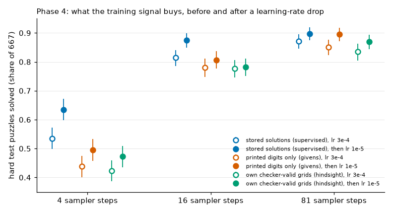

# Phase 4 summary: a small masked diffusion model on 9×9 Sudoku

A set of small experiments on one small model. Nothing here is a new method, and none of it says how these objectives behave on a large dLLM.

- **Data** (4.0): 100,002 train, 1,002 val and 2,001 test puzzles from a local generator, one third each in three bands by number of blank cells (easy 30–40, medium 41–50, hard 51–56). Unique solutions, no solution shared across splits.
- **Model** (4.1): the phase 2 architecture at 1.86M parameters, masked diffusion loss, batch 256, lr 3e-4 constant, stopped by a plateau rule at step 43,546 (4 h 58 min).
- **Score**: share of puzzles filled with a rule-valid grid that keeps the givens, greedy `confidence` sampler, 4 / 16 / 81 unmasking steps. Unless stated, numbers are the **hard test band (667 puzzles)**; brackets are 95% bootstrap intervals over puzzles of a paired difference. Most arms have one or three training seeds, so the intervals cover puzzle sampling, not seed variance.
- Every step has a README in `experiments/4.x/` with the exact command, the predictions committed before the run and a check of each prediction. Roughly half of those predictions did not hold; they are kept.

## The short version

1. **On 9×9 the number of sampler steps and the unmasking order matter a lot**, the opposite of the converged 4×4 toy. The supervised model solves 0.535 / 0.814 / 0.871 of the hard band at 4 / 16 / 81 steps; with a random order 0.13 at 16 steps against 0.81 with the confidence rule; a perfect order would solve every puzzle with the same weights (4.1, 4.2).
2. **Failures are one or two early wrong cells followed by cells that fit them** (4.4b). Given the exact set of wrong cells, mask-and-re-predict solves 0.91 at 4 passes; with any score the model or the rules provide, remasking gains at most 0.02. A detector would have to find about nine wrong cells in ten; a linear readout of the frozen model finds six (4.5b, 4.6b).
3. **No RL objective tested here beat a learning-rate drop.** From the constant-lr model, 500 RL steps at lr 1e-5 gave up to +0.067 at 4 sampler steps (training on the model's own valid grids), and that was read for a while as a gain from self-training (4.4). Continuing the plain supervised training for 4,000 steps at lr 1e-5 gives +0.099 (4.9e), and from that model the same self-training step adds nothing (−0.005 [−0.027, +0.017]) and costs 0.03 at 16 steps (4.9f). The 4.4 ranking of objectives, and 4.5a, 4.6c and 4.6d which share its start, compare objectives on a model that had this free gain available.
4. **The push-down term of wd1 never paid.** Plain wd1 is the only objective that lowered the start in 4.4 (−0.030), bounded versions gain less than every pull-up objective, no single factor of a five-factor regime map changes the sign (4.6c), and from the supervised model after its lr drop plain wd1 loses 0.077 at 4 steps [−0.106, −0.051] where the same objective without the push-down term loses 0.012 [−0.033, +0.009] (4.9g).
5. **The objectives do not follow the gradient of the solve rate.** In an exact-gradient audit the pull-up objectives are nearly orthogonal to the score-function gradient and still raise the valid share by as much as a step along it (4.6a).
6. **A model can be trained with no stored solution at all, and the rule checker adds little to that.** Masking and re-predicting the printed digits of the puzzles alone (no rollouts, no checker) reaches 0.438 / 0.780 / 0.850 at the supervised step count, and 0.495 / 0.807 / 0.895 after the lr drop (4.8a, 4.8e, 4.9d). A loop that harvests its own checker-valid grids (98.7% of the hard train puzzles found) is ahead early and not at the end: 0.472 / 0.783 / 0.870 (4.8b to 4.8d, 4.9d).
7. **Stored solutions are still worth 0.14 at 4 steps and 0.07 at 16 once both sides had the lr drop**, and nothing at 81 steps (0.897 against 0.895) (4.9e). The givens-only deficit sits in the first pass on the puzzle as given, on cells with two or more candidates left (4.9a). After the drop, 500 steps on the label-free model's own checker-valid grids still add 0.033 at 4 steps [+0.007, +0.060] and nothing at 16, which leaves the gap at 0.11 / 0.07 (4.9h; no control arm from that start).

## Main table: hard test band, valid share

| model | training signal | 4 steps | 16 steps | 81 steps |
|---|---|---|---|---|
| supervised (4.1) | stored solutions, lr 3e-4 | 0.535 | 0.814 | 0.871 |
| `sft_lr1e-5` (4.9e) | + 4,000 steps at lr 1e-5 | 0.634 | 0.874 | 0.897 |
| `givens_long` (4.8e) | printed digits only, lr 3e-4 | 0.438 | 0.780 | 0.850 |
| `givens_lr1e-5` (4.9d) | + 4,000 steps at lr 1e-5 | 0.495 | 0.807 | 0.895 |
| `hindsight_long` (4.8d) | own checker-valid grids + givens, lr 3e-4 | 0.423 | 0.777 | 0.835 |
| `hindsight_lr1e-5` (4.9d) | + 4,000 steps at lr 1e-5 | 0.472 | 0.783 | 0.870 |

`givens_lr1e-5` − `sft_lr1e-5`: −0.139 / −0.068 / −0.002. `hindsight_lr1e-5` − `givens_lr1e-5`: −0.023 [−0.060, +0.012] / −0.024 [−0.053, +0.006] / −0.026 [−0.050, 0.000]. One run per row.

## RL objectives from the constant-lr supervised model (4.4), with the later caveat

500 steps, lr 1e-5, hard train puzzles, 4-step rollouts, groups of 8, three seeds pooled; difference to the start (0.535) at 4 sampler steps:

| objective | test, 4 steps |
|---|---|
| self-training (diffusion loss on own valid grids) | +0.067 |
| positive-only wd1 (β = 0) | +0.054 |
| filtered imitation | +0.051 |
| GRPO-style | +0.018 |
| wd1 with a floor on the negative term | +0.013 |
| wd1 + KL to the start | +0.009 |
| wd1 | −0.030 |

Read with 4.9e and 4.9f: the supervised model continued at the same low learning rate, with no RL, is at +0.099. What the table still supports is the order *within* it: pulling valid rollouts up is harmless to useful, pushing invalid ones down is not. What it does not support is "RL improves this model".

Follow-ups from the same start: a sampled unmasking order gives more unequal-reward groups and no gain; weights over the batch give +0.030 over floored wd1, up to the level of filtered imitation (4.5a). Supervised steps on the same puzzles give the same +0.07 whichever puzzles carry the loss (4.6d), which was the first sign that the gain was not about the data.

## Closing checks from the models that had the lr drop (4.9g, 4.9h)

Two questions were left open by 4.9f, each answered with three seeds of 500 steps, predictions committed first (all held).

| start | 500 steps of | test, 4 steps | test, 16 steps |
|---|---|---|---|
| `sft_lr1e-5` (0.634 / 0.874) | self-training (4.9f) | −0.005 [−0.027, +0.017] | −0.028 |
| | more supervised steps (4.9f) | −0.002 | −0.013 |
| | positive-only wd1, β = 0 (4.9g) | −0.012 [−0.033, +0.009] | −0.019 [−0.036, −0.004] |
| | wd1 (4.9g) | −0.077 [−0.106, −0.051] | −0.051 [−0.071, −0.031] |
| `givens_lr1e-5` (0.495 / 0.807) | training on own checker-valid grids (4.9h) | +0.033 [+0.007, +0.060] | −0.002 [−0.023, +0.021] |

- **4.9g.** Without the free gain of the learning rate, the sign that 4.4 still supported holds and is larger: plain wd1 loses 0.077, the same code without its push-down term loses 0.012, and the difference between them is +0.065 [+0.041, +0.090]. As in 4.4 the estimated likelihood of the valid rollouts falls together with that of the invalid ones (−57 → −65).
- **4.9h.** On the label-free model the finishing step on own valid grids still adds 0.033 at 4 steps after the drop (it added 0.077 before it, 4.9b) and nothing at 16. There is no control arm from this start, so the 0.033 is not attributed to the checker. The run was interrupted from outside and resumed from its saved state; see its README.

With these, the best label-free model is at 0.528 / 0.805 / 0.895 and the best supervised one at 0.634 / 0.874 / 0.897 (the 81-step value on the label-free side is that of `givens_lr1e-5`; the 4.9h models were read at 4 and 16 steps only).

## Learning with no stored solutions (4.8, 4.9a to 4.9d)

The question, in the user's words: give the model many puzzles and zero solutions, plus a tool that says whether a filled grid is right. How far does it get?

- **Cold start** (4.8a): the tool is not needed to start. Hide some of the printed digits, train the model to put them back. One hour gives about half of the hard val band at 16 steps. This depends on how the puzzles were made: givens here are a random subset of the cells of a full grid.
- **Checker loop** (4.8b, 4.8c): keep the model's own grids that pass the checker and train on them (`harvest`), or also re-mask them on arbitrary cells (`hindsight`). At 19,546 steps both are ahead of continuing the givens loss, mostly at 4 steps (+0.12 to +0.14 on val with two control seeds); hindsight adds +0.07 over harvest at 81 steps in every seed and nothing at 4 or 16.
- **End point** (4.8d, 4.8e): continued to the supervised step count, the givens-only control catches up with the hindsight loop at every budget on test. The early lead was a head start.
- **Finishing step** (4.9b, 4.9c): 500 steps at lr 1e-5 on own valid grids lift both label-free models to about 0.52 at 4 steps; at lr 3e-4 the same step loses.
- **Learning rate alone** (4.9d): the long runs continued with their own training at lr 1e-5 gain +0.05 at 4 steps and +0.04 at 81. About three quarters of the finishing step's gain is the learning rate.

A tool that says *which cells* are wrong was not used: it needs the solution or a solver and would be label use (see `docs/SELF_LEARNING_FROM_CHECKER.md`).

## Readings that were corrected along the way

Kept here because the corrections are the most useful part of the phase.

| first reading | where | corrected by | what was wrong |
|---|---|---|---|
| hindsight beats harvest at 4 steps | 4.8b, one seed | 4.8c | a low harvest seed |
| the checker loop beats givens-only training | 4.8b, 4.8c at 19,546 steps | 4.8e | a head start, not a higher end point |
| the label-free loops plateau 0.07 to 0.10 below supervised | 4.8d, 4.8e | 4.9d | part of the plateau level was the constant learning rate |
| after the finishing step the label-free model matches supervised at 4 steps | 4.9b | 4.9e | the supervised reference had no low-lr tail; like for like the gap is 0.14 |
| self-training gains +0.067 on the supervised model | 4.4 | 4.9e, 4.9f | the gain is the low learning rate of the RL step |

The common cause of the last three: every model was trained at a constant learning rate, and every later step ran at a lower one. A learning-rate decay in 4.1 would have removed the confound from the start.

## Limits

- One small model (1.86M parameters), one generator, one training seed for each long run; three seeds for the 500-step arms. Intervals are over puzzles.
- The hard test band was read many times across 4.4 to 4.9; differences of 0.02 to 0.03 between experiments should not be trusted.
- One low learning rate (1e-5), applied as a step change; no schedule was tuned, and the supervised model was still improving when its low-lr run stopped.
- The puzzles are not hard by human standards: 68% of the hard band falls to naked and hidden singles (4.0).
- The wd1 implementation is hand-written from the paper and uses the one-step likelihood estimate, which is about 50 nats from the exact one here (4.6a); the paper's setting (pretrained 8B model, LoRA) differs in almost everything.
- MPS is not bit-deterministic; reruns move by a few thousandths.

## Experiments

| id | what | 
|---|---|
| [4.0](../../experiments/4.0/README.md) | data and the data gate |
| [4.1](../../experiments/4.1/README.md) | model size check, supervised training to a plateau |
| [4.2](../../experiments/4.2/README.md) | sampler strategies, order headroom, calibration |
| [4.3](../../experiments/4.3/README.md) | choosing the RL start (hard band, 4 steps) |
| [4.4](../../experiments/4.4/README.md) | the phase 3 objectives on 9×9 |
| [4.4b](../../experiments/4.4b/README.md) | where rollouts fail, without training |
| [4.5a](../../experiments/4.5a/README.md) | sampled order × batch weights on floored wd1 |
| [4.5b](../../experiments/4.5b/README.md) | remasking at inference |
| [4.6a](../../experiments/4.6a/README.md) | exact-gradient audit of the objectives |
| [4.6b](../../experiments/4.6b/README.md) | how good a detector of wrong cells must be |
| [4.6c](../../experiments/4.6c/README.md) | regime map for the push-down term |
| [4.6d](../../experiments/4.6d/README.md) | supervised arms on the self-training puzzles |
| [4.8a](../../experiments/4.8a/README.md) | cold start on the givens only |
| [4.8b](../../experiments/4.8b/README.md), [4.8c](../../experiments/4.8c/README.md) | checker loop: harvest, hindsight, seeds |
| [4.8d](../../experiments/4.8d/README.md), [4.8e](../../experiments/4.8e/README.md) | both continued to the supervised step count, test evaluation |
| [4.9a](../../experiments/4.9a/README.md) | what the givens-only model learned |
| [4.9b](../../experiments/4.9b/README.md), [4.9c](../../experiments/4.9c/README.md) | finishing step on own valid grids, learning-rate check |
| [4.9d](../../experiments/4.9d/README.md), [4.9e](../../experiments/4.9e/README.md) | learning-rate drop on the label-free and the supervised model |
| [4.9f](../../experiments/4.9f/README.md) | self-training after the drop |
| [4.9g](../../experiments/4.9g/README.md), [4.9h](../../experiments/4.9h/README.md) | closing checks |

Background memos (literature, no experiments): `docs/RL_DLLM_SURVEY.md`, `docs/RL_DLLM_DIRECTIONS.md`, `docs/SELF_LEARNING_FROM_CHECKER.md`, `docs/SAMPLE_EFFICIENT_SELF_LEARNING.md`.
