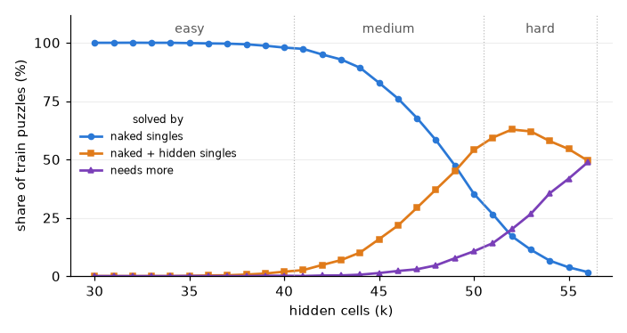

# Phase 4, step 4.0: data report

Built by `python -m phase4.analysis data` from the cache in `~/dllm-cache/phase4` (generator seed 0, scale 1.0). Report time: 3 s.

## Gate

| check | result | note |
|---|---|---|
| Every stored solution is valid, agrees with the givens, and is the only solution (all val and test, 5,000 train) | PASS |  |
| No solution shared across splits, also after digit relabelling; no duplicates inside a split | PASS |  |
| Digit frequency per position consistent with 1/9 | PASS | largest deviation 3.85 standard errors |
| Hidden cells spread evenly over the 81 positions in every band | PASS | largest deviation below 4.5 standard errors in every band |
| Bands differ in difficulty (share solved by naked singles drops by more than 10 points per band) | PASS |  |
| The hard band contains puzzles that singles do not solve | PASS | 32.1% of test |
| "Repeat until stuck" does not solve everything in every band | PASS | easy 99.4%; medium 76.6%; hard 10.5% |

**Gate: PASS.** Training may start.

Limit of this dataset: puzzles come from hiding random cells of random grids. They are easier than curated hard collections, and the difficulty classes use only two solving techniques, so "needs more" is a mixed bag.

## 1. Sizes and generation

| split | easy | medium | hard | total |
|---|---|---|---|---|
| train | 33,334 | 33,334 | 33,334 | 100,002 |
| val | 334 | 334 | 334 | 1,002 |
| test | 667 | 667 | 667 | 2,001 |

Generation: 92.5 s with 4 processes, 103,005 solved grids drawn. Grids dropped as repeats: {'test': 0, 'val': 0, 'train': 0}.

A removal order is kept only if it hides exactly k cells with the solution still unique. Share of orders kept, by k:

| k | 30 | 31 | 32 | 33 | 34 | 35 | 36 | 37 | 38 | 39 | 40 | 41 | 42 | 43 | 44 | 45 | 46 | 47 | 48 | 49 | 50 | 51 | 52 | 53 | 54 | 55 | 56 |
|---|---|---|---|---|---|---|---|---|---|---|---|---|---|---|---|---|---|---|---|---|---|---|---|---|---|---|---|
| kept | 1.00 | 1.00 | 1.00 | 1.00 | 1.00 | 1.00 | 1.00 | 1.00 | 1.00 | 1.00 | 1.00 | 1.00 | 1.00 | 1.00 | 1.00 | 1.00 | 1.00 | 1.00 | 1.00 | 1.00 | 1.00 | 1.00 | 1.00 | 1.00 | 1.00 | 0.97 | 0.85 |

## 2. Correctness

- **train** (100,002 puzzles): stored solution valid 100,002/100,002; givens agree with it 100,002/100,002; hidden cells equal k 100,002/100,002; k inside its band 100,002/100,002; solver finds exactly one solution on 5,000/5,000 checked, equal to the stored one on 5,000/5,000 (random sample).
- **val** (1,002 puzzles): stored solution valid 1,002/1,002; givens agree with it 1,002/1,002; hidden cells equal k 1,002/1,002; k inside its band 1,002/1,002; solver finds exactly one solution on 1,002/1,002 checked, equal to the stored one on 1,002/1,002 (all).
- **test** (2,001 puzzles): stored solution valid 2,001/2,001; givens agree with it 2,001/2,001; hidden cells equal k 2,001/2,001; k inside its band 2,001/2,001; solver finds exactly one solution on 2,001/2,001 checked, equal to the stored one on 2,001/2,001 (all).

The validity check here is a separate numpy implementation, not the solver. The solver itself is tested on published puzzles (`tests/test_sudoku9.py`): Norvig's grid1 with its known solution, a 17-given puzzle and Inkala's 2012 puzzle (one solution each), and a grid with a removed rectangle (exactly two solutions).

## 3. Leakage and duplicates

- train: 100,002 distinct solutions, 100,002 distinct after digit relabelling, 100,002 distinct puzzles, of 100,002.
- val: 1,002 distinct solutions, 1,002 distinct after digit relabelling, 1,002 distinct puzzles, of 1,002.
- test: 2,001 distinct solutions, 2,001 distinct after digit relabelling, 2,001 distinct puzzles, of 2,001.
- train ∩ val: 0 shared solutions, 0 after digit relabelling.
- train ∩ test: 0 shared solutions, 0 after digit relabelling.
- val ∩ test: 0 shared solutions, 0 after digit relabelling.

Not checked: equivalence under the other Sudoku symmetries (row/column permutations inside a band, band and stack permutations, transposition). Two such grids look different cell by cell but share structure.

## 4. Digit balance (train solutions)

Frequency of each digit in each of the 81 positions: min 0.1085, max 0.1149 (uniform: 0.1111). Largest deviation is 3.85 standard errors; for 729 independent uniform frequencies the largest would be 3.31 at the median and 4.84 at the 99.9th percentile (rough reference: the 729 frequencies are not independent).

## 5. Hidden cells and givens (train)

| band | mean hidden | hidden share per position, min–max | max \|z\| | givens per row, mean (min–max) | per column | per box | puzzles with an empty row, column or box |
|---|---|---|---|---|---|---|---|
| easy | 35.0 | 0.424–0.440 | 2.93 | 5.11 (0–9) | 5.11 (0–9) | 5.11 (0–9) | 0.8% |
| medium | 45.5 | 0.552–0.568 | 3.71 | 3.94 (0–9) | 3.94 (0–9) | 3.94 (0–9) | 8.7% |
| hard | 53.5 | 0.653–0.666 | 2.90 | 3.06 (0–9) | 3.06 (0–8) | 3.06 (0–8) | 27.1% |

z compares each position's hidden share with the band average; with 81 positions a largest value near 3 is expected by chance. Positions are not exactly exchangeable, because the uniqueness filter depends on the grid.

## 6. Difficulty and rule baselines

Difficulty class by logic: solved by naked singles alone (a cell with one candidate, repeated until stuck); solved once hidden singles are added (a digit with one possible cell in a unit); solved by neither.

| split | band | puzzles | naked singles | naked + hidden singles | needs more |
|---|---|---|---|---|---|
| train | easy | 33,334 | 99.5% | 0.4% | 0.0% |
| train | medium | 33,334 | 74.2% | 22.7% | 3.1% |
| train | hard | 33,334 | 11.2% | 57.7% | 31.1% |
| test | easy | 667 | 99.4% | 0.6% | 0.0% |
| test | medium | 667 | 76.6% | 22.2% | 1.2% |
| test | hard | 667 | 10.5% | 57.4% | 32.1% |

Stored classes recomputed on the test split: all equal.

Baselines on the test split, with no learning:

| band | one pass: puzzles solved | one pass: hidden cells filled | of the filled, correct | repeat until stuck (naked singles): puzzles solved | with hidden singles too |
|---|---|---|---|---|---|
| easy | 0.0% | 32.5% | 100.0% | 99.4% | 100.0% |
| medium | 0.0% | 10.6% | 100.0% | 76.6% | 98.8% |
| hard | 0.0% | 2.8% | 100.0% | 10.5% | 67.9% |

By number of hidden cells (train):

| k | puzzles | naked singles | naked + hidden singles | needs more |
|---|---|---|---|---|
| 30 | 2,993 | 100.0% | 0.0% | 0.0% |
| 31 | 3,033 | 100.0% | 0.0% | 0.0% |
| 32 | 3,055 | 100.0% | 0.0% | 0.0% |
| 33 | 2,980 | 100.0% | 0.0% | 0.0% |
| 34 | 3,031 | 100.0% | 0.0% | 0.0% |
| 35 | 3,080 | 99.8% | 0.1% | 0.1% |
| 36 | 3,017 | 99.7% | 0.3% | 0.0% |
| 37 | 2,991 | 99.6% | 0.4% | 0.0% |
| 38 | 3,069 | 99.3% | 0.7% | 0.0% |
| 39 | 3,019 | 98.7% | 1.1% | 0.2% |
| 40 | 3,066 | 97.9% | 1.9% | 0.2% |
| 41 | 3,245 | 97.3% | 2.6% | 0.1% |
| 42 | 3,386 | 94.9% | 4.8% | 0.3% |
| 43 | 3,283 | 92.8% | 6.9% | 0.3% |
| 44 | 3,359 | 89.3% | 10.1% | 0.6% |
| 45 | 3,369 | 82.8% | 15.9% | 1.3% |
| 46 | 3,425 | 76.1% | 21.7% | 2.2% |
| 47 | 3,320 | 67.7% | 29.3% | 3.0% |
| 48 | 3,355 | 58.2% | 37.1% | 4.6% |
| 49 | 3,332 | 47.4% | 44.9% | 7.7% |
| 50 | 3,260 | 35.3% | 54.1% | 10.6% |
| 51 | 5,621 | 26.5% | 59.3% | 14.1% |
| 52 | 5,514 | 17.1% | 62.8% | 20.1% |
| 53 | 5,481 | 11.3% | 62.0% | 26.7% |
| 54 | 5,807 | 6.6% | 57.9% | 35.5% |
| 55 | 5,457 | 3.8% | 54.4% | 41.8% |
| 56 | 5,454 | 1.8% | 49.5% | 48.7% |



## 7. Ten test puzzles per band

One line per puzzle (row-major, `.` = hidden), with k and difficulty class. The first of each band is also drawn.

**easy**

```
. . . | . . 5 | . . .
1 . 5 | . 9 2 | 7 . .
. 2 9 | . . 8 | 1 5 .
------+-------+------
8 . . | . 5 . | 9 1 .
. . 2 | . . 7 | 8 4 .
7 9 1 | 8 4 . | . 2 5
------+-------+------
. . 3 | 7 . . | . 6 .
2 8 . | 5 6 1 | 4 3 9
5 4 . | . . 9 | 2 7 .

.....5...1.5.927...29..815.8...5.91...2..784.79184..25..37...6.28.56143954...927.  k=39  naked + hidden singles
...7...14246.153877...6.9.535.184.....43..89.1.8.96.4.597.4.23.83..2.47646....1.9  k=36  naked singles
.93..61.82.89.35765..218493..15.28373.71.9..2..24...5.7.539....12...5.8.639824..5  k=33  naked singles
8.73..5.4415.8...9..3..521867849..533...5...2..2138.46.3.524687.8.9..4357..863.21  k=32  naked singles
3..4.91..1.4823....8..1.3...5139.......2869512.6....389.75.1..6635..821...89..57.  k=40  naked singles
...2..83..2487.95.1.75..6.4..53.2....317.82652961.....51......6..348..72742.531..  k=39  naked singles
....87.51.8.4127.3...9658..826.314.719.2.65...538..1.623....6..96812..7571..532.9  k=34  naked singles
....46371..9.3.586..75.192..4.89.15.9....54...53.1.6.2...658....8.1.92.5..5324.19  k=39  naked singles
..5392.1..385.497292..1...3.52.8.3.7..72.65..3.9..7..8..1643.25..3..5....748....9  k=40  naked singles
9.264581.7643.8.5..15.7..4325..61..8.865.73.1.....34..598.3..7.641....39...9.6..4  k=37  naked singles
```

**medium**

```
. 7 1 | . 4 . | 3 . 9
4 . . | 8 . . | . 1 .
3 . 8 | . . 1 | 7 . .
------+-------+------
. 9 2 | 3 . 5 | . . .
. 1 . | . . 2 | . . .
7 3 5 | . . . | 1 . .
------+-------+------
1 . . | 7 8 9 | . . 5
. . . | . . . | . . .
2 8 . | . . . | 9 6 .

.71.4.3.94..8...1.3.8..17...923.5....1...2...735...1..1..789..5.........28....96.  k=50  naked + hidden singles
46837...9.7..59...5.1.4.36...549....7..5.62....9..21.58....4...1..8.7943.3..6.8..  k=45  naked singles
93..85..1.71..2......6..8.3.4857.692...416....57928...7.285.43.3....79.5.69..41..  k=41  naked singles
.2.4....1..8.716.4..5........23.486758.....39364..7.1265924..7.24.78..958.39.....  k=41  naked singles
..1..7..4.8.3....1..5....3....4.3.8.81..9.64.9..1...7319.8....52.4.16....582...16  k=48  naked + hidden singles
8.952.7.4.65......2..31...54....23819.....456...6..9..72..6514..5.29.8..6...315.7  k=43  naked singles
138.5.97.2....9.1.69.187..548.7..63.3769...51.2.....8..456.........7.563.....12.7  k=43  naked singles
.2.796..575......69......745.3.2..878.4.5761.2..64..933794..26818....74..4......1  k=41  naked singles
62.9.4.3.19.32.7.....68..2.8527....3....532.43..2.968...51..34...9468..2.1..3...7  k=42  naked singles
...4.8.....1..65..947.2316..15..2.........49.83.6...5...87...1...3..5...75413..26  k=48  naked singles
```

**hard**

```
. . . | 2 8 3 | 5 . .
. . 9 | . . 5 | . . .
. . 8 | . . 6 | 2 1 .
------+-------+------
. . 3 | 9 7 1 | . . .
. . . | 6 . . | . . 1
7 4 . | 5 . . | . . .
------+-------+------
. 7 . | 4 6 2 | . . .
9 . . | . 1 . | 4 . .
. . 4 | . 5 . | 6 2 .

...2835....9..5.....8..621...3971......6....174.5......7.462...9...1.4....4.5.62.  k=51  naked + hidden singles
..86.71453...2.............1.4....3....4...5..6...9.74.37..5.1948..92.639........  k=52  naked singles
8....9.25.6....4....4...813.43..1...91........5.46....47..8....1..35..493.....1.8  k=52  naked + hidden singles
2..3.47.6761.....2...6.2..........83..4.9.....2...61..8....9.7.1...3..6...6..7928  k=52  naked + hidden singles
..817..5..6.....8.15...8...8...3........6..7.725..46....37.14......8.7..4..5....2  k=54  naked + hidden singles
61....8...27....69....6............7.4..7.2162.6..5.4...1..84328...96.7....14.6..  k=51  naked + hidden singles
....36.5...8....9.6.....31...5...2.....46.93..4.2...65.....4.....4..8.7.92...35.8  k=54  naked + hidden singles
.....31..78....9..1..4...78..7.9...1628.4..3.....5..6.........2..3.21.9.97..85..4  k=52  naked singles
....8..4..6......1..17..25...........25.184.3.98..512............935.8.6.3....7..  k=55  naked + hidden singles
12..8..3.7.....5.8.9..63..4...2..4.....4...8.3.9.5...1.7.6.29......9.7.3.65.4....  k=52  naked singles
```

